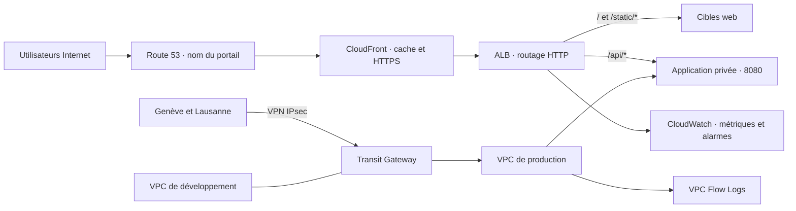

# Rapport de réalisation · Satom Cloud Network

## Mandat et architecture

Léman Finance est une entreprise fictive avec un siège à Genève, une agence à Lausanne et un portail de gestion de portefeuilles dans AWS. Le projet met en place le réseau qui relie les bureaux au portail, contrôle les accès entre production et développement et permet de diagnostiquer une panne.

Le lab est réalisé à Stockholm (`eu-north-1`). Les templates CloudFormation sont versionnés sur GitHub. Les commandes servent à déployer et à tester les stacks. Les captures du README montrent les résultats et, selon les étapes, les vues de la console AWS.

Le schéma représente l’architecture cible. Les modules 9 à 13 utilisent un VPC de test séparé avec le même plan d’adressage. Cela permet de rejouer le déploiement et la suppression complète du portail sans perturber les ressources des modules 1 à 8.

### Adresses et ports du lab

| Élément | Adresse ou plage | Usage |
| --- | --- | --- |
| VPC de production | `10.0.0.0/16` | Web et application |
| Sous-réseaux publics A et B | `10.0.1.0/24` et `10.0.5.0/24` | Entrée ALB et cibles web |
| Cibles web | `10.0.1.10` et `10.0.5.10` | HTTP 80 depuis l’ALB |
| Sous-réseau et cible privée | `10.0.2.0/24` et `10.0.2.10` | API 8080 depuis l’ALB pour le portail |
| VPC de développement | `10.1.0.0/16` | Environnement de test |
| Siège et agence | `192.168.10.0/24` et `192.168.20.0/24` | Réseaux des bureaux reliés par VPN dans le scénario |

## Du besoin client aux tests

### 0 · Cadrer le projet

Le cahier des charges fixe les besoins de Léman Finance. Nous avons relevé les sites, les environnements, les plages d’adresses IP et les vérifications attendues. Les noms portent le marqueur `bko` et les tags permettent de repérer les ressources du projet et d’en suivre les coûts. [Cahier des charges](https://hackmd.io/@Formateur/BkLzKMvRMe)

### 1 · Créer le réseau de production

CloudFormation crée le VPC de production `10.0.0.0/16`, un sous-réseau public `10.0.1.0/24` pour `web-01` et un sous-réseau privé `10.0.2.0/24` pour `app-01`. Les tests vérifient la communication interne et le comportement avant la configuration d’une sortie Internet. Un **VPC** est un réseau virtuel dans AWS. Un **sous-réseau** est une partie de ce réseau, dans une zone de disponibilité. [Captures du module 1](README.md#module-1--tp-1)

### 2 · Configurer les chemins réseau

On a associé une table de routage à chaque sous-réseau. Le public passe par l’**Internet Gateway**. Le privé sort via la **NAT Gateway**, qui utilise une adresse publique pour les connexions initiées par les machines privées. On a retiré puis rétabli une route pour observer l’échec puis le retour de la connectivité. [Captures du module 2](README.md#module-2--tp-1--routage-public)

### 3 · Filtrer les flux

On a limité les échanges entre les machines avec des **Security Groups**, qui filtrent au niveau de leur interface et suivent l’état des connexions. Les **NACL** s’appliquent au sous-réseau et filtrent l’aller et le retour séparément. Le TP montre qu’une règle de retour manquante suffit à bloquer un échange. [Captures du module 3](README.md#module-3--security-groups-et-nacl)

### 4 · Inspecter le trafic avec Network Firewall

On a déployé une politique de pare-feu, les règles, le journal et les routes qui dirigent les flux vers le point d’inspection. Après un refus initial lié à une politique d’organisation, le pare-feu a été déployé. Le dépôt Amazon Linux autorisé a répondu, le site de contrôle a été bloqué et CloudWatch a enregistré le rejet. Les ressources temporaires du pare-feu ont ensuite été supprimées. Une **SCP** est une politique d’AWS Organizations qui peut interdire une action même à un rôle disposant de droits élevés. [Captures du module 4](README.md#module-4--network-firewall)

### 5 · Relier deux VPC directement

On a créé un VPC de développement puis ajouté un **VPC Peering**, c’est-à-dire une liaison privée directe entre deux VPC. Avec les bonnes routes et permissions, le flux testé atteint l’application sur le port 8080. Les autres exercices vérifient les limites du peering lorsque les plages d’adresses se chevauchent ou lorsqu’on cherche à utiliser une liaison comme intermédiaire. [Captures du module 5](README.md#module-5--vpc-peering)

### 6 · Centraliser les connexions

La **Transit Gateway** relie plusieurs réseaux à une passerelle centrale. On a rattaché les VPC de production et de développement, configuré leurs tables et vérifié le trafic. Retirer une propagation de retour a provoqué un échec, puis son rétablissement a remis la connexion en service. Une **propagation** permet d’apprendre des routes depuis un réseau attaché. [Captures du module 6](README.md#module-6--transit-gateway)

### 7 · Relier les bureaux par VPN

AWS a provisionné deux connexions Site-to-Site et deux tunnels par site. La table des sites dirigeait le trafic vers `app-01`. Les adresses publiques réservées à la démonstration ont laissé les tunnels AWS à l’état `DOWN`. Le lab Linux isolé a vérifié le filtrage et la reprise sur le deuxième tunnel. Un **VPN IPsec** chiffre les paquets entre deux réseaux. Une **Customer Gateway** représente le routeur du site dans AWS. Les VPN temporaires ont été supprimés après les vérifications. [Captures du module 7](README.md#module-7--vpn-site-to-site)

### 8 · Prévoir une liaison dédiée et tester le secours

On a calculé qu’il faut en moyenne 0,556 Gbit/s pour transférer 2 To en huit heures, puis retenu 1 Gbit/s. Le Direct Connect Gateway a été associé à la Transit Gateway dans AWS. Un tunnel GRE a représenté la liaison dédiée en local. **BGP** a échangé les préfixes, préféré GRE, basculé vers IPsec et rétabli le chemin principal. Le projet a conservé la passerelle sans commander de port physique. [Captures du module 8](README.md#module-8--direct-connect)

### 9 · Distribuer les requêtes du portail

On a créé un **ALB** sur deux zones de disponibilité. Ce répartiteur de charge lit le chemin de la requête. Il envoie `/` aux serveurs web sur le port 80 et `/api/*` à l’API privée sur 8080. Un **listener** écoute sur un port, ici 443 pour HTTPS. Un **target group** liste les serveurs qui traitent un type de requête, et un **health check** teste régulièrement qu’ils répondent. Le test a validé HTTPS avec un certificat de lab et la réponse de la cible web de secours. Les deux essais contiennent chacun une expiration. Lors du deuxième essai, cinq réponses sur six sont venues de `web-02`. La continuité sans interruption reste à valider. [Captures du module 9](README.md#module-9--application-load-balancer)

### 10 · Résoudre les noms et basculer vers la maintenance

On a créé une **zone DNS privée** associée au VPC. Depuis une cible web, `app.prod.leman.internal` renvoyait `10.0.2.10`. Pour la partie publique, le serveur Route 53 interrogé directement a d’abord renvoyé l’ALB. Après l’arrêt des deux cibles web, il a renvoyé l’adresse de maintenance `203.0.113.50`, puis il est revenu à l’ALB. Un **alias Route 53** pointe vers une ressource AWS dont les adresses peuvent changer. Le **failover DNS** modifie la réponse DNS quand le primaire est en panne. L’adresse de maintenance et le domaine `.example` sont réservés à la démonstration. [Captures du module 10](README.md#module-10--route-53)

### 11 · Mettre en cache les contenus statiques

On a placé CloudFront devant l’ALB. Le test a donné un `Hit` sur le fichier statique et un `Miss` sur chaque requête à l’API. Un **CDN** sert des contenus depuis des points de présence répartis géographiquement. Le **TTL** indique combien de temps le CDN peut conserver une réponse. Une **invalidation** retire les copies en cache pour que la prochaine requête récupère le fichier depuis l’origine. Elle a produit un nouveau `Miss` lors du test. Après verrouillage, l’accès direct à l’ALB expirait, tandis que l’API répondait via CloudFront. Un premier changement a tenté de remplacer les instances qui occupaient déjà leurs adresses IP fixes. La change set corrigée réutilisait le template déployé et limitait le changement au groupe de sécurité et aux listeners. Le lab utilise le certificat HTTPS de CloudFront côté visiteur et HTTP vers l’ALB. Un domaine réel et des certificats valides sont nécessaires pour le parcours HTTPS de bout en bout prévu par le cahier des charges. [Captures du module 11](README.md#module-11--cloudfront)

### 12 · Voir une panne et retrouver sa cause

CloudWatch rassemble les métriques de santé, de latence et d’erreurs. Le test produit des erreurs 500 volontaires depuis l’application, avec un seuil de plus de cinq erreurs sur deux périodes de cinq minutes. **SNS** diffuse les alertes. Une file **SQS** reçoit la notification réelle du passage de `OK` à `ALARM`. Le test utilise cette file comme destinataire contrôlé. Le template propose aussi un abonnement e-mail avec confirmation. L’alarme est revenue à `OK` lorsque le nombre d’erreurs est passé sous le seuil. Les **VPC Flow Logs** enregistrent les métadonnées d’un flux, comme ses adresses, son port et l’action `ACCEPT` ou `REJECT`. **Logs Insights** a compté les trois connexions SSH rejetées entre les deux instances du lab. [Captures du module 12](README.md#module-12--cloudwatch-sns-et-vpc-flow-logs)

### 13 · Recréer le portail à partir du code

On a créé la stack réseau depuis le YAML, puis relu une **change set**, la liste des changements prévus, avant d’ajouter le portail. La détection de **drift** a signalé le groupe de sécurité modifié en dehors de CloudFormation. Une fois la règle fictive retirée, AWS a indiqué `IN_SYNC`. On a supprimé la stack, recréé le VPC et le portail à partir du YAML, puis obtenu une réponse HTTPS de l’API et vérifié le fichier statique sur le nouveau déploiement. Un **rollback** est le retour à l’état précédent après un échec de déploiement, lorsque CloudFormation peut le restaurer. [Captures du module 13](README.md#module-13--infrastructure-reproductible)

## Vocabulaire à retenir

| Terme | En mots simples |
| --- | --- |
| **CIDR**, par exemple `10.0.2.0/24` | La notation qui décrit une plage d’adresses réseau. Le nombre après la barre représente le nombre de bits communs. |
| **Zone de disponibilité** | Un emplacement d’infrastructure isolé au sein d’une même région AWS. Répartir les cibles sur deux zones limite l’impact d’une panne d’une zone. |
| **Route** et **filtre** | Une route choisit la destination suivante du paquet. Un filtre décide s’il peut passer. |
| **GRE**, **IPsec** et **BGP** | GRE encapsule des paquets dans un tunnel. IPsec protège les paquets par chiffrement. BGP échange les routes et aide à choisir le chemin. |
| **TLS** et **ACM** | TLS protège les échanges HTTPS. ACM stocke et gère les certificats utilisés par les services AWS. |
| **DNS**, **enregistrement A** et **NS** | Le DNS traduit un nom en information exploitable. Un enregistrement A donne une adresse IPv4. Les enregistrements NS indiquent quels serveurs font autorité pour la zone. |
| **HTTP 5xx** | Une réponse indiquant qu’un serveur ou une passerelle a rencontré une erreur. L’ALB distingue les erreurs générées par ses cibles de celles qu’il génère lui-même. |
| **IAM** | Le service qui définit les identités et les permissions. Le rôle des Flow Logs permet au service d’écrire dans CloudWatch Logs. |
| **Template**, **stack** et **IaC** | Le template décrit les ressources. La stack est l’ensemble déployé par CloudFormation. L’IaC consiste à gérer ces ressources depuis des fichiers de code versionnés. |

## Rejouer les étapes du portail

1. Déployer [le template réseau](cloudformation/reseau-leman.yaml) avec `DeployPortal=false` pour créer le VPC. Appliquer une change set avec `DeployPortal=true` pour ajouter les cibles et l’ALB. Renseigner `CertificateArn` avec un certificat ACM de la même région pour activer 443.
2. Déployer [Route 53](cloudformation/10-route53.yaml) avec les sorties `VpcId`, `AlbDns` et `AlbZone` du portail. Le paramètre `Endpoint` sélectionne l’alias simple, la bascule vers la maintenance ou l’alias CloudFront.
3. Déployer [CloudFront](cloudformation/11-cloudfront.yaml) avec `AlbDns` et une valeur secrète pour `OriginHeader`. Utiliser cette même valeur pour limiter l’origine dans le template du portail, avec l’identifiant de la liste de préfixes AWS CloudFront de la région. Transmettre le domaine de la distribution à la stack DNS.
4. Déployer [la supervision](cloudformation/12-supervision.yaml) avec les sorties du portail et l’identifiant de la distribution. Créer les ressources IAM avec `CAPABILITY_IAM`. L’API du lab fournit des routes de diagnostic pour provoquer une erreur 500 et une tentative TCP 22 depuis la cible applicative.
5. Supprimer les stacks de supervision, DNS et CloudFront à la fin des essais, puis la stack du portail. La zone DNS privée est associée au VPC et doit être supprimée avant lui.

Les tests du domaine public réel supposent une délégation DNS valide. Pour le parcours HTTPS de bout en bout, le certificat de l’origine ALB couvre son nom réel, et celui de la distribution pour l’alias est installé dans `us-east-1`.

### Démonstration sur un vrai domaine

Le [template de zone déléguée](cloudformation/10-zone-deleguee.yaml) crée une zone Route 53 pour le seul sous-domaine du portail. Dans la zone parente, ajouter sur ce sous-domaine les quatre serveurs `NameServers` renvoyés par la stack. Avec `PortalTarget=cloudfront`, un alias dirige le portail vers CloudFront et un deuxième alias dirige le nom `origine` vers l’ALB.

Le [template du certificat régional](cloudformation/demo-certificat.yaml) valide en DNS le nom d’origine. Le certificat du portail est demandé dans ACM en `us-east-1`, puis son enregistrement de validation est déclaré dans la zone déléguée. Le portail public utilise `LabDiagnostics=false` pour désactiver les routes de test qui provoquent des erreurs ou génèrent du trafic de diagnostic. L’ALB autorise sur 443 uniquement le préfixe d’origine CloudFront et vérifie l’en-tête configuré dans les deux stacks.

## Périmètre des coûts

Le lab a été exécuté sur un compte de formation partagé. Le cahier fixe une enveloppe de 150 CHF et une alerte à 80 %. Aucun budget `bko` n’était visible. L’API de facturation a refusé l’accès aux tags d’allocation depuis ce compte membre. Le seuil et les coûts exacts de l’équipe restent donc à confirmer côté compte de gestion. Le portail a été recréé une fois, testé, puis supprimé. Les stacks DNS, CloudFront et supervision du lab et le certificat de test ont aussi été retirés. Les instances des modules initiaux sont arrêtées. La passerelle NAT et les attachements de référence restent en place et peuvent continuer à générer des frais. [Tags d’allocation AWS](https://docs.aws.amazon.com/awsaccountbilling/latest/aboutv2/activating-tags.html)

## Sources

- [Cahier des charges Satom IT & Learning Solutions](https://hackmd.io/@Formateur/BkLzKMvRMe)
- [Tarification des load balancers AWS](https://aws.amazon.com/elasticloadbalancing/pricing/)
- [Tarification de Route 53](https://aws.amazon.com/route53/pricing/)
- [Tarification de CloudFront](https://aws.amazon.com/cloudfront/pricing/)
- [IANA · domaine réservé .example](https://www.iana.org/domains/root/db/example.html)
- [AWS · HTTPS entre CloudFront et une origine personnalisée](https://docs.aws.amazon.com/AmazonCloudFront/latest/DeveloperGuide/using-https-cloudfront-to-custom-origin.html)
