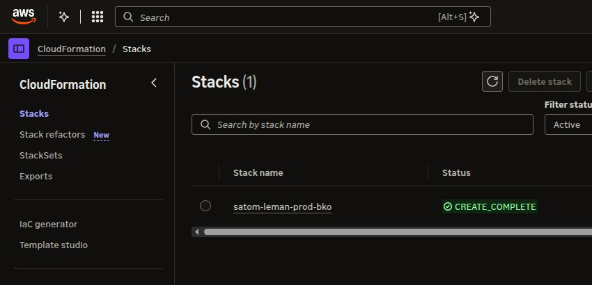
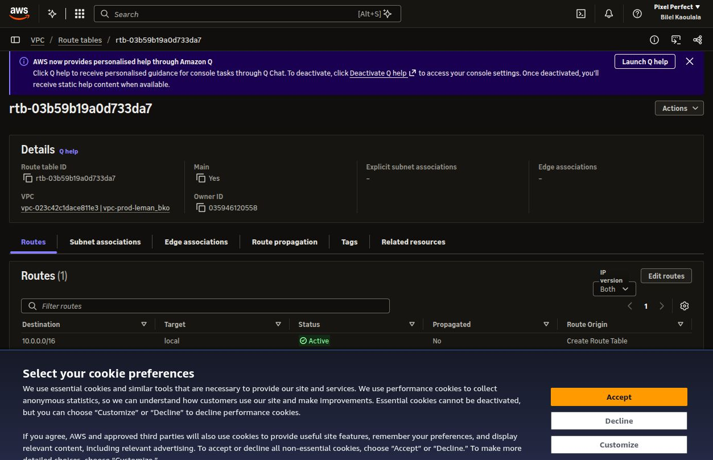
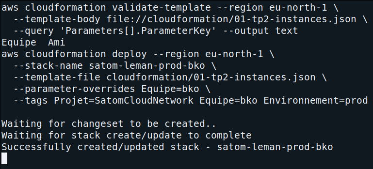
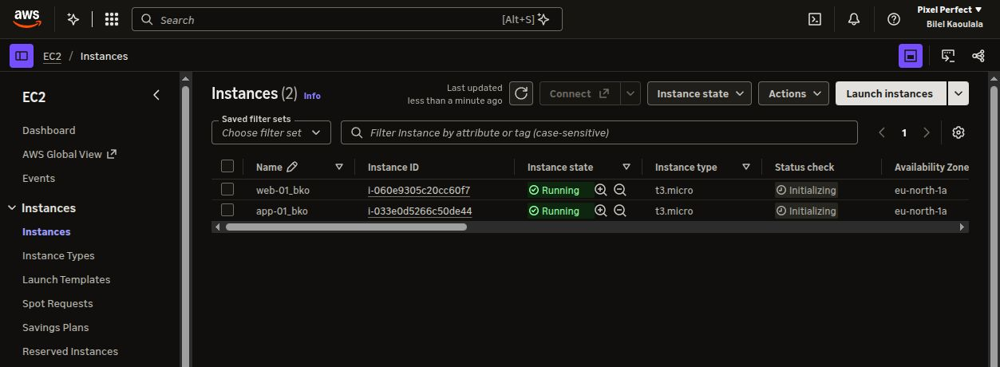

# Satom Cloud Network — Groupe Léman Finance

Projet du cours AWS E3. La région du lab est Stockholm (`eu-north-1`). Les ressources sont définies dans CloudFormation et les changements sont versionnés dans Git.

Les noms de ressources prennent le suffixe `_bko`. Pour les services dont le nom interdit le caractère souligné, utiliser `-bko`, comme pour la stack CloudFormation. Les tags obligatoires du cours gardent leurs valeurs, dont le nom exact de l’équipe.

## Module 1 — TP 1

Le [template](cloudformation/01-tp1-reseau.json) crée `vpc-prod-leman_bko` et les sous-réseaux `sub-public-1a_bko` et `sub-prive-1a_bko` en zone `eu-north-1a`. Il prend le nom de l'équipe en paramètre.

**Déployé le 16 novembre 2026.** La stack `satom-leman-prod-bko` est en `CREATE_COMPLETE`. Le VPC `vpc-prod-leman_bko` utilise le CIDR `10.0.0.0/16` et les tags `Projet=SatomCloudNetwork`, `Equipe=bko` et `Environnement=prod`.

| Sous-réseau | CIDR | Zone |
|---|---|---|
| `sub-public-1a_bko` | `10.0.1.0/24` | `eu-north-1a` |
| `sub-prive-1a_bko` | `10.0.2.0/24` | `eu-north-1a` |

La table de routage principale contient une seule entrée, `10.0.0.0/16 → local`.

### Réalisation du TP 1 en captures

**1.** CloudFormation valide le template à Stockholm et reconnaît le paramètre d’équipe.

**2.** La commande de déploiement est relancée. CloudFormation confirme que la stack est déjà à jour.

**3.** La console CloudFormation affiche la stack en CREATE_COMPLETE.

**4.** La console VPC affiche le réseau de production vpc-prod-leman_bko.

**5.** Les deux sous-réseaux sont disponibles avec leurs plages IP respectives.

**6.** La table principale contient uniquement la route locale 10.0.0.0/16.

## Module 1 — TP 2 · Instances et connectivité

[Template CloudFormation](cloudformation/01-tp2-instances.json). Les instances utilisent les adresses privées `10.0.1.10` et `10.0.2.10`. Le script de démarrage exécute les pings sur les instances et les sorties sont lues depuis la console série EC2.

**1.** Validation du template et mise à jour de la stack pour ajouter les deux instances.

**2.** La console EC2 montre web-01_bko et app-01_bko en cours d’exécution dans eu-north-1a.

**3.** Depuis web-01_bko, le ping vers 10.0.2.10 reçoit quatre réponses sur quatre.

**4.** Depuis app-01_bko, le ping vers 8.8.8.8 ne reçoit aucune réponse avant l’ajout du routage Internet.

## Étapes suivantes

| Étape | Changement à versionner | Preuve |
|---|---|---|
| Module 1, TP 3 | Définition temporaire du sous-réseau qui chevauche le réseau public | Refus AWS et plan d’adressage |
| Module 2 | Passerelle Internet, NAT et tables de routage | Routes et tests de sortie avant retrait, pendant retrait et après rétablissement |
| Module 3 | Groupes de sécurité et NACL | Tests HTTPS et 8080, tests de blocage et règles rétablies |
| Module 4 | Network Firewall, routes symétriques et CloudWatch Logs | Pare-feu prêt, trafic autorisé et bloqué, journaux et nettoyage |

Les captures documentent les états déployés et les tests. Les modifications temporaires des routes et des règles passent aussi par CloudFormation.
