# Satom Cloud Network — Groupe Léman Finance

Projet du cours AWS E3. La région du lab est Stockholm (`eu-north-1`). Les ressources sont définies dans CloudFormation et les changements sont versionnés dans Git.

Les noms de ressources prennent le suffixe `_bko`. Pour les services dont le nom interdit le caractère souligné, utiliser `-bko`, comme pour la stack CloudFormation. Les tags obligatoires du cours gardent leurs valeurs, dont le nom exact de l’équipe.

## Module 1 — TP 1

Le [template](cloudformation/01-tp1-reseau.json) crée `vpc-prod-leman_bko` et les sous-réseaux `sub-public-1a_bko` et `sub-prive-1a_bko` en zone `eu-north-1a`. Il prend le nom de l'équipe en paramètre.

**Déployé le 16 novembre 2026.** La stack `satom-leman-prod-bko` est en `CREATE_COMPLETE`. Le VPC `vpc-prod-leman_bko` utilise le CIDR `10.0.0.0/16` et les tags `Projet=SatomCloudNetwork`, `Equipe=bko` et `Environnement=prod`.

| Sous-réseau | CIDR | Zone |
|---|---|---|
| `sub-public-1a_bko` | `10.0.1.0/24` | `eu-north-1a` |
| `sub-prive-1a_bko` | `10.0.2.0/24` | `eu-north-1a` |

La table de routage principale contient une seule entrée, `10.0.0.0/16 → local`.

### Réalisation du TP 1 en captures

**1.** CloudFormation valide le template à Stockholm et reconnaît le paramètre d’équipe.

**2.** La commande de déploiement est relancée. CloudFormation confirme que la stack est déjà à jour.

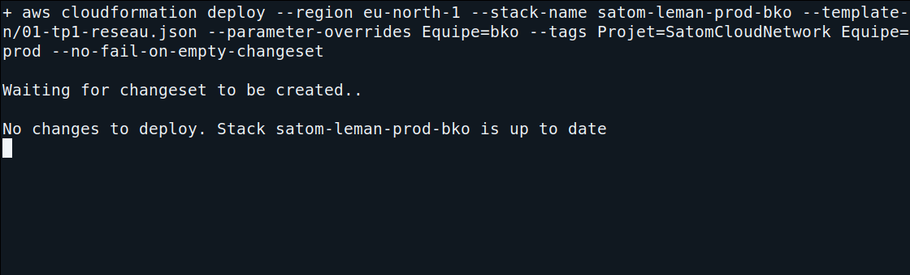

**3.** La console CloudFormation affiche la stack en CREATE_COMPLETE.

**4.** La console VPC affiche le réseau de production vpc-prod-leman_bko.

**5.** Les deux sous-réseaux sont disponibles avec leurs plages IP respectives.

**6.** La table principale contient uniquement la route locale 10.0.0.0/16.

## Module 1 — TP 2 · Instances et connectivité

[Template CloudFormation](cloudformation/01-tp2-instances.json). Les instances utilisent les adresses privées `10.0.1.10` et `10.0.2.10`. Le script de démarrage exécute les pings sur les instances et les sorties sont lues depuis la console série EC2.

**1.** Validation du template et mise à jour de la stack pour ajouter les deux instances.

**2.** La console EC2 montre web-01_bko et app-01_bko en cours d’exécution dans eu-north-1a.

**3.** Depuis web-01_bko, le ping vers 10.0.2.10 reçoit quatre réponses sur quatre.

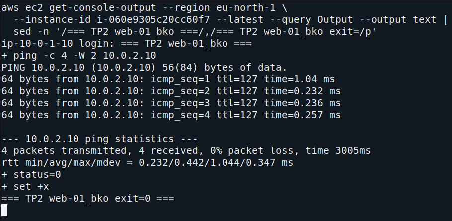

**4.** Depuis app-01_bko, le ping vers 8.8.8.8 ne reçoit aucune réponse avant l’ajout du routage Internet.

## Module 1 — TP 3 · Plan d’adressage et chevauchement

Le [template de test](cloudformation/01-tp3-chevauchement.json) tente de créer le bloc `10.0.1.128/25` dans le VPC de production depuis une stack dédiée. AWS renvoie `CREATE_FAILED` avec le motif « conflicts with another subnet ». Le bloc testé est inclus dans `10.0.1.0/24`.

| Périmètre | Bloc IPv4 | Zone | Affectation |
|---|---|---|---|
| `vpc-prod-leman_bko` | `10.0.0.0/16` | Stockholm | Production |
| `sub-public-1a_bko` | `10.0.1.0/24` | `eu-north-1a` | `web-01_bko` à `10.0.1.10` |
| `sub-prive-1a_bko` | `10.0.2.0/24` | `eu-north-1a` | `app-01_bko` à `10.0.2.10` |
| Sous-réseau données | `10.0.3.0/24` | `eu-north-1a` prévue | Réservé dans le plan |
| VPC développement | `10.1.0.0/16` | Stockholm | Réservé pour le module 5 |

Le sous-réseau privé offre **251 adresses attribuables**. Un `/24` contient 256 adresses, dont 5 sont réservées par AWS. La plage attribuable va de `10.0.2.4` à `10.0.2.254`. L’adresse de broadcast théorique est `10.0.2.255`, réservée par AWS. Le `/24` laisse de la place pour ajouter des instances et le plan garde des blocs distincts pour les autres usages du lab. Le plan est prêt pour la validation de l’Architecte réseau.

**1.** Le terminal montre la tentative de déploiement et le motif du refus remonté par CloudFormation.

**2.** L’onglet Events de CloudFormation affiche le refus de créer `SubnetChevauchant`.

**3.** Le terminal confirme que le VPC contient les deux sous-réseaux prévus.

## Module 2 — TP 1 · Routage public

[Template CloudFormation](cloudformation/02-tp1-routage-public.json). La passerelle `igw-prod-leman_bko` est attachée au VPC de production. Une Elastic IP est associée à `web-01_bko`. Le test utilise EC2 Instance Connect avec une clé temporaire et un accès SSH limité à l’IPv4 du poste.

**1.** Validation du template puis mise à jour de la stack CloudFormation.

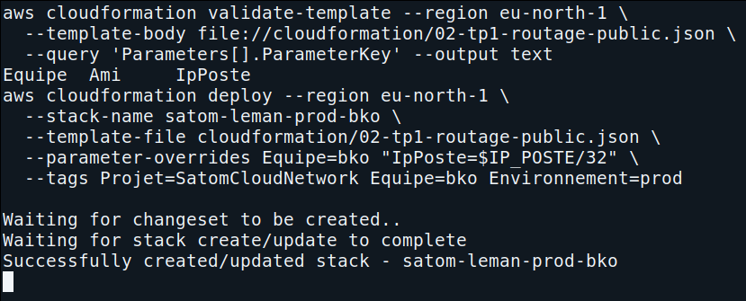

**2.** La console VPC affiche l’association de `rt-public-leman_bko` à `sub-public-1a_bko` et la route active `0.0.0.0/0` vers la passerelle Internet.

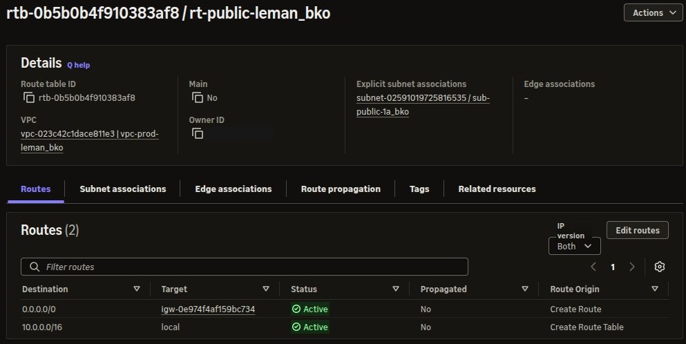

**3.** Le poste rejoint `web-01_bko` en SSH via son IP publique. Depuis cette instance, le ping vers `8.8.8.8` reçoit quatre réponses sur quatre.

## Module 2 — TP 2 · Routage privé et NAT

[Template CloudFormation](cloudformation/02-tp2-routage-prive.json). La NAT Gateway est dans le sous-réseau public. La table du sous-réseau privé envoie le trafic Internet vers cette passerelle. Le SSH de test vers app-01_bko est limité au groupe de sécurité de web-01_bko.

**1.** Validation et déploiement CloudFormation du NAT et de la table privée.

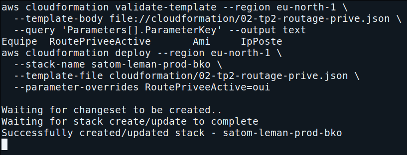

**2.** La console VPC confirme l’association à sub-prive-1a_bko et la route active 0.0.0.0/0 vers le NAT.

**3.** Le test lancé sur app-01_bko via le relais SSH web-01_bko reçoit quatre réponses sur quatre depuis 8.8.8.8.

**4.** app-01_bko ne possède pas d’IP publique. Une tentative SSH depuis le poste vers l’IP publique du NAT expire.

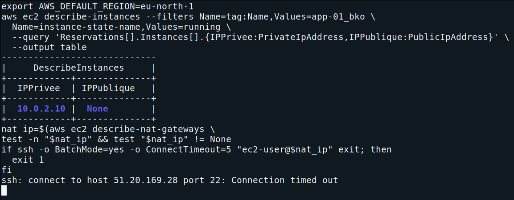

## Module 2 — TP 3 · Diagnostic d’une route manquante

[Template CloudFormation](cloudformation/02-tp2-routage-prive.json). Le paramètre RoutePriveeActive pilote la route privée. Le test du TP 2 sert de référence avant le retrait.

**1.** CloudFormation retire temporairement la route par défaut avec RoutePriveeActive=non.

**2.** La table privée reste liée à sub-prive-1a_bko et affiche uniquement la route locale.

**3.** Sans route par défaut, le ping depuis app-01_bko vers 8.8.8.8 perd les quatre paquets.

**4.** CloudFormation recrée la route par défaut avec RoutePriveeActive=oui.

**5.** La console affiche de nouveau la route par défaut active vers la NAT Gateway.

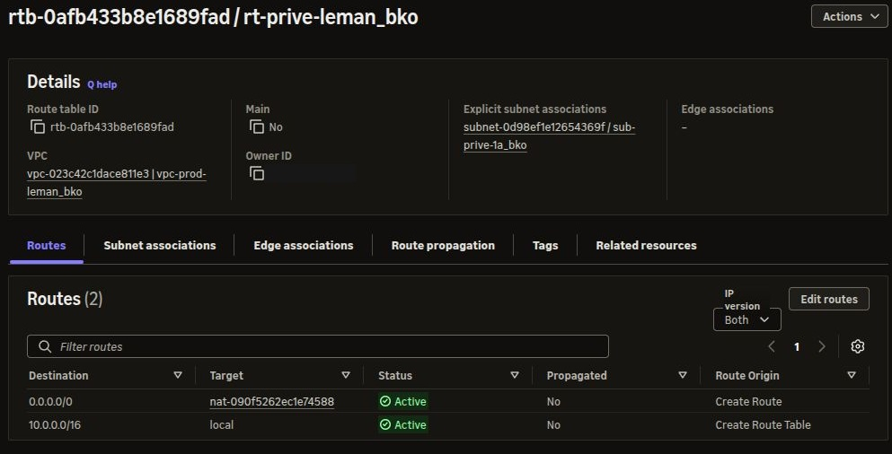

**6.** Après rétablissement, app-01_bko reçoit quatre réponses sur quatre.

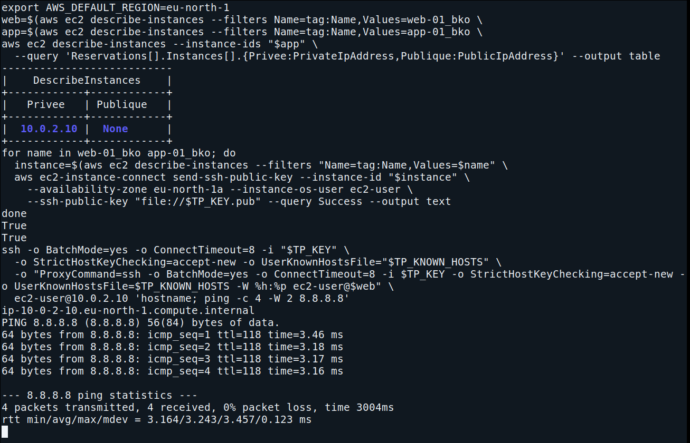

### Procédure de diagnostic

1. Vérifier la table associée au sous-réseau. Le [sous-réseau public](modules/02-routage/tp1/02-route-publique.jpg) utilise `rt-public-leman_bko`. Le sous-réseau privé utilise `rt-prive-leman_bko`.
2. Dans la table concernée, vérifier la présence de `0.0.0.0/0`.
3. Vérifier que la route pointe vers la bonne cible. La table privée utilise le NAT et la table publique utilise la passerelle Internet.
4. Confirmer que la route est active et que sa cible est disponible. Refaire le ping pour valider le rétablissement.

La procédure est prête pour la validation du responsable qualité.

## Module 3 · Security Groups et NACL

### TP 1 · Groupes de sécurité

sg-web_bko autorise TCP 443 depuis Internet et TCP 22 depuis l’IPv4 du poste de test, utilisée pour représenter la salle Cornavin. sg-app_bko autorise TCP 22 et 8080 depuis sg-web_bko. L’application garde son IP privée 10.0.2.10. Le certificat de lab est vérifié avec curl.

[Template CloudFormation](cloudformation/03-tp1-security-groups.json).

**Validation et déploiement des groupes de sécurité par CloudFormation.**

**Règles du groupe web dans la console EC2.**

**Règles du groupe applicatif avec le groupe web comme source.**

**Installation des deux services de démonstration avec le script versionné.**

**Le HTTPS public répond et le serveur web atteint l’application sur le port 8080. L’instance applicative n’a pas d’IP publique.**

### TP 2 · Retour de trafic et NACL

Un groupe de sécurité mémorise les connexions autorisées. Une NACL évalue indépendamment les deux sens. Le test HTTPS est lancé depuis app-01_bko vers l’IP privée de web-01_bko pour tester la règle de retour sans utiliser l’exception de retour SSH du poste.

[Template CloudFormation](cloudformation/03-tp2-tp3-nacl.json).

**CloudFormation crée la NACL et l’associe au sous-réseau public.**

**La règle entrante 100 autorise le port 443.**

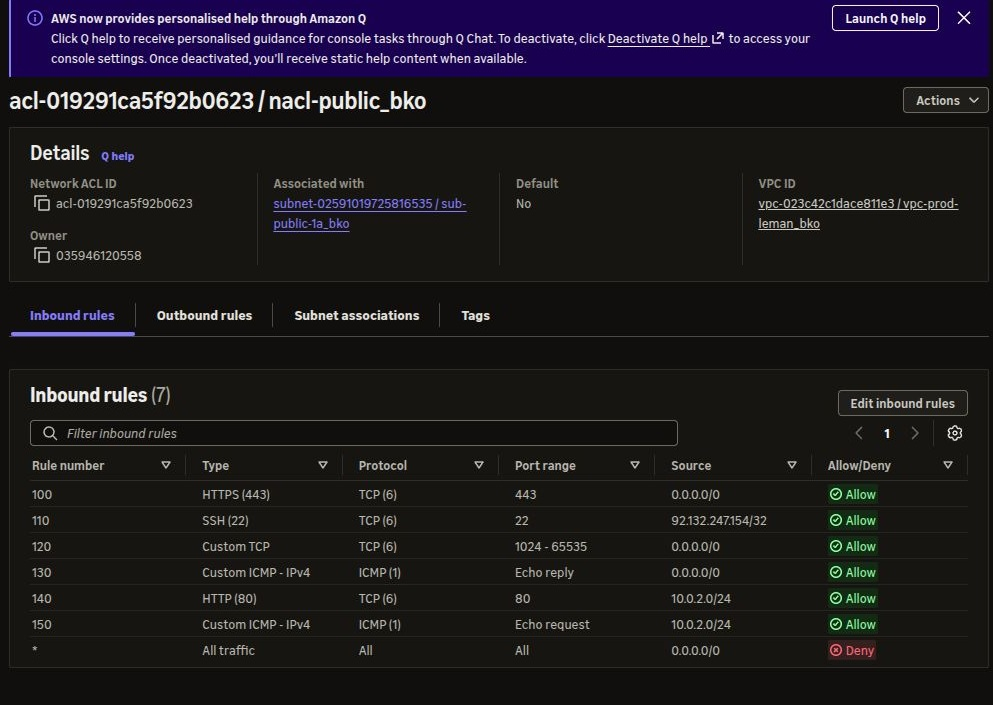

**La règle sortante 100 autorise les ports de retour 1024 à 65535.**

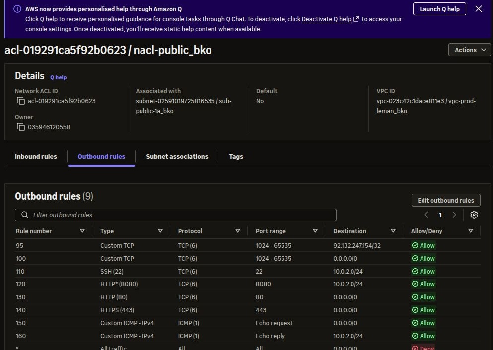

**L’appel HTTPS aboutit avec les règles de référence.**

**Le paramètre RetourHttps=non retire la règle sortante 100.**

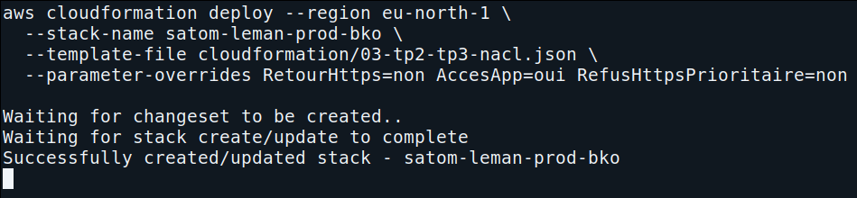

**L’onglet sortant montre la NACL sans la règle 100.**

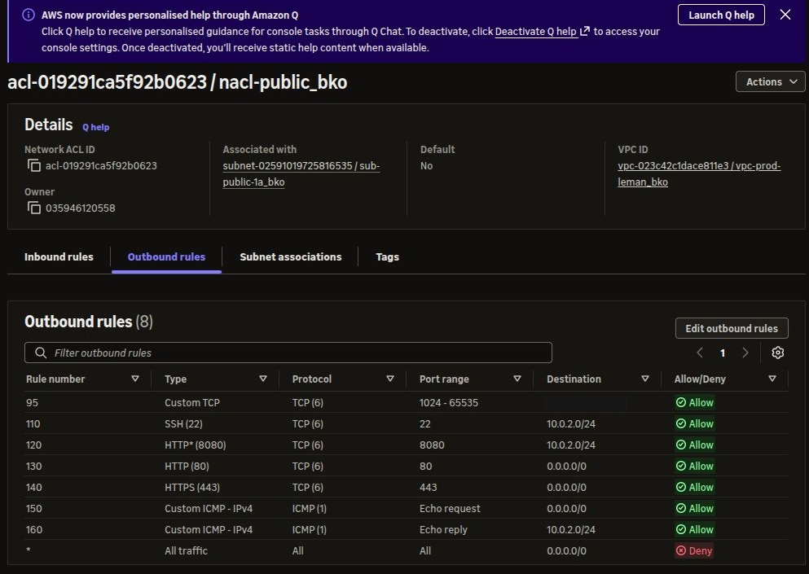

**Le même appel HTTPS expire avec le code curl 28.**

**CloudFormation rétablit la règle de retour.**

### TP 3 · Diagnostic d’un blocage

Les règles NACL sont examinées par numéro croissant. La première règle qui correspond décide du sort du paquet. Le refus 90 prend donc effet avant l’autorisation 100.

[Template CloudFormation](cloudformation/03-tp2-tp3-nacl.json).

**CloudFormation retire l’autorisation 8080 de sg-app_bko.**

**L’appel de web-01_bko vers app-01_bko:8080 expire.**

**CloudFormation rétablit le port applicatif et ajoute le refus HTTPS numéro 90.**

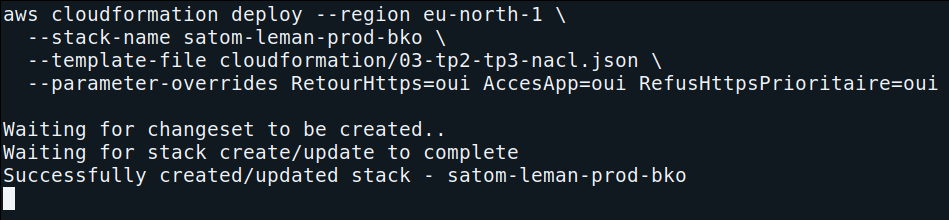

**Dans la console, le refus HTTPS 90 apparaît avant l’autorisation 100.**

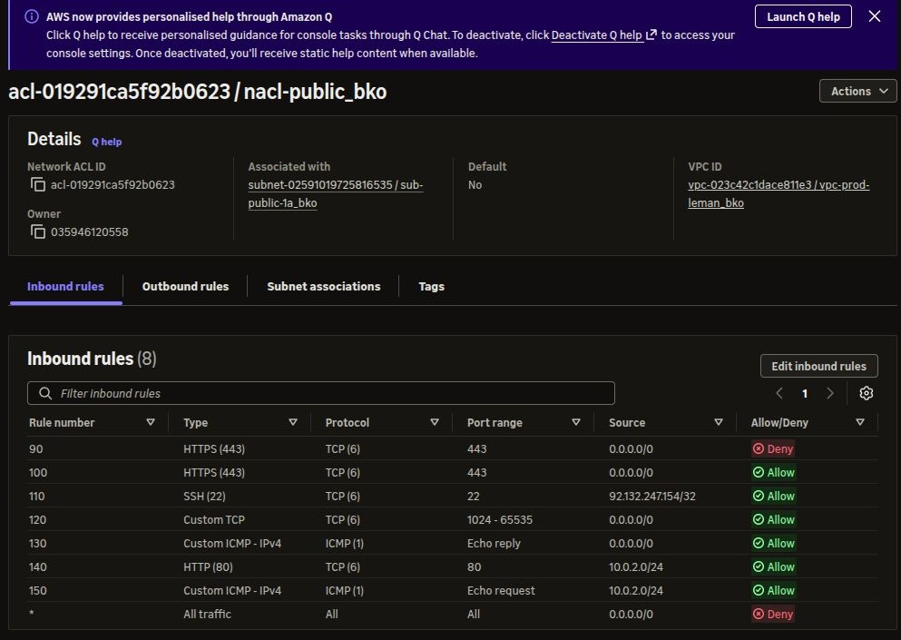

**Le test HTTPS expire avec le refus prioritaire actif.**

**La configuration de référence est rétablie dans CloudFormation.**

**Le serveur web atteint de nouveau l’application sur 8080.**

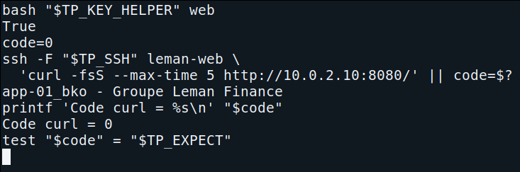

**L’appel HTTPS réussit de nouveau.**

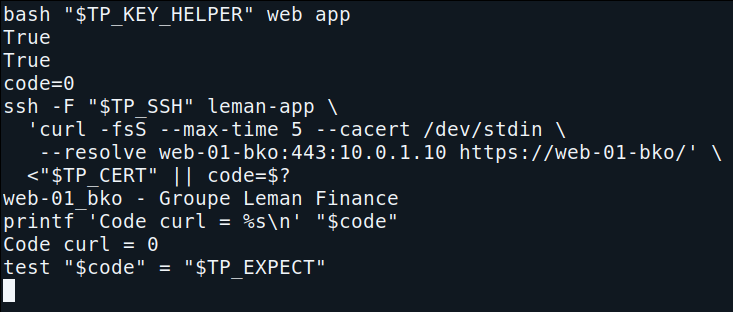

### Diagnostic

1. Identifier le groupe attaché à l’interface de la cible.
2. Vérifier le protocole, le port et la source autorisée dans les règles du groupe.
3. Examiner les NACL des sous-réseaux traversés dans les deux sens. Comparer les numéros des règles et vérifier les ports de retour.
4. Confirmer la route vers la destination, puis relancer le test applicatif.

### Schéma du filtrage

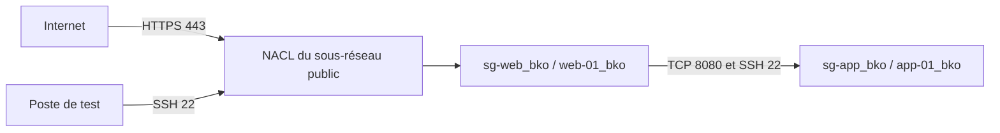

## Module 4 · Network Firewall

**État du module · déploiement et filtrage vérifiés.** Lors du premier essai, le compte de l’école refuse explicitement `network-firewall:CreateFirewallPolicy` à Stockholm. Le test a été fait dans la stack séparée `satom-leman-nfw-bko`, qui a terminé en `ROLLBACK_COMPLETE`. Aucun endpoint de pare-feu n’a été créé.

### TP 1 · Tentative de déploiement

Le [template CloudFormation](cloudformation/04-tp1-network-firewall.json) prévoit le sous-réseau dédié `sub-fw-1a_bko` (`10.0.4.0/28`), la politique et le pare-feu. Les identifiants de compte ont été masqués dans les captures du refus.

**1.** Le terminal montre la validation CloudFormation, la tentative de déploiement et le refus de l’opération de création de politique.

**2.** La console CloudFormation montre la ressource Politique en CREATE_FAILED.

**3.** Le retour arrière est terminé. Aucun sous-réseau `10.0.4.0/28` ne reste dans le VPC, et la route privée par défaut est toujours active vers le NAT du module 2.

### Nouvel essai · Politique créée

Le [template de vérification](cloudformation/04-reessai-policy.json) a créé `policy-prod-leman-bko` sur le compte d’origine à Stockholm, dans la stack `satom-leman-policy-bko`. Cette stack gère la politique seule. Pour la suite, référencer cette politique ou retirer la stack de vérification avant de redéployer un template qui crée une politique du même nom.

**Terminal.** CloudFormation termine le déploiement de la politique.

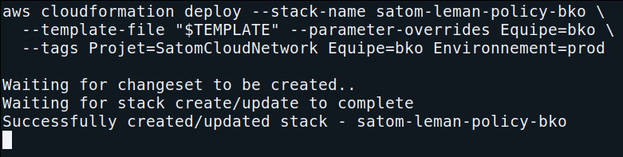

**Console AWS.** La politique est visible dans Network Firewall.

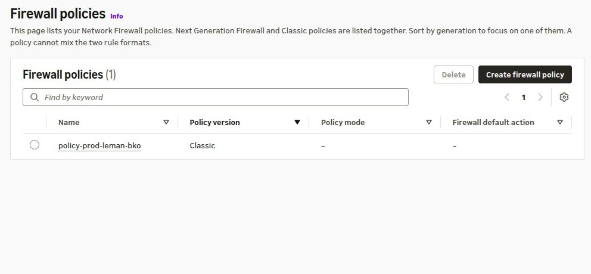

### TP 2 et TP 3 · Conception initiale

Le [template de filtrage et de journalisation](cloudformation/04-tp2-regles-journaux.json) prend les domaines approuvés en paramètre. Il prévoit la liste blanche HTTP et HTTPS et la livraison des alertes et flux dans CloudWatch Logs. Le [template de routage](cloudformation/04-tp3-routage-inspection.json) prend en paramètre le sous-réseau et l’endpoint du pare-feu. CloudFormation a validé les deux fichiers. Le déploiement a ensuite utilisé les variantes ci-dessous.

| Table | Destination | Cible prévue pendant le test |
|---|---|---|
| Privée applicative | `0.0.0.0/0` | Endpoint du pare-feu |
| Sous-réseau du pare-feu | `0.0.0.0/0` | NAT d’inspection temporaire |
| Sous-réseau du NAT d’inspection | `0.0.0.0/0` | Passerelle Internet |
| Sous-réseau du NAT d’inspection | `10.0.2.0/24` | Même endpoint pour le retour |

Le NAT d’inspection utilise le sous-réseau séparé `10.0.5.0/28`. Sa route retour permet de faire passer les deux sens par le même pare-feu sans modifier la table du serveur web. [Documentation AWS sur le retour symétrique](https://docs.aws.amazon.com/transform/latest/userguide/vpc-webapp-access.html).

### Réalisation après rétablissement des accès

Le pare-feu a été créé dans une stack qui référence la politique existante. [Template de l’endpoint](cloudformation/04-tp1-endpoint.json). AWS interdit de modifier l’ordre d’évaluation d’une politique déjà créée. Une nouvelle politique en ordre strict a donc été associée à l’endpoint. Le domaine retenu pour le test est le dépôt Amazon Linux 2023 configuré sur `app-01_bko`. Les deux destinations CloudWatch, alertes et flux, ont été activées. [Politique stricte](cloudformation/04-tp2-policy-strict.json) et [template de journalisation](cloudformation/04-tp2-endpoint-journaux.json).

Le quota d’Elastic IP du compte partagé a refusé une allocation supplémentaire. Le NAT de référence a été retiré par CloudFormation en conservant son Elastic IP, puis cette même adresse a été associée à un NAT d’inspection dans `10.0.5.0/28`. Le trafic aller et retour a traversé le même endpoint. [Template effectif de routage](cloudformation/04-tp3-routage-eip-partagee.json).

**La console affiche le pare-feu en état Ready.**

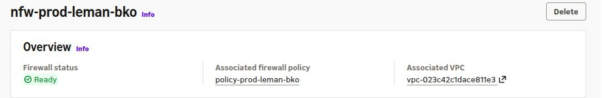

**L’endpoint est en état Ready à Stockholm et la politique de filtrage est associée.**

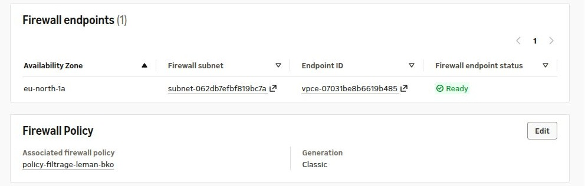

**CloudFormation crée la politique stricte avec le domaine du dépôt du lab.**

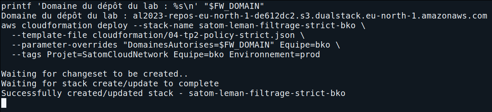

**La politique stricte est associée au pare-feu. Le terminal affiche les groupes CloudWatch pour FLOW et ALERT.**

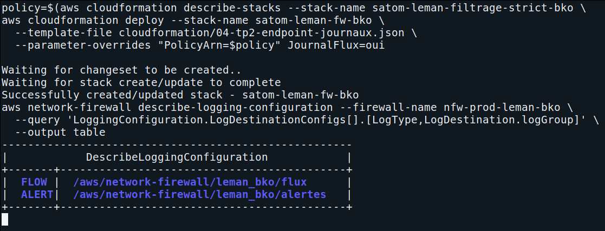

**Avant la bascule, le dépôt et example.com renvoient tous deux HTTP 200.**

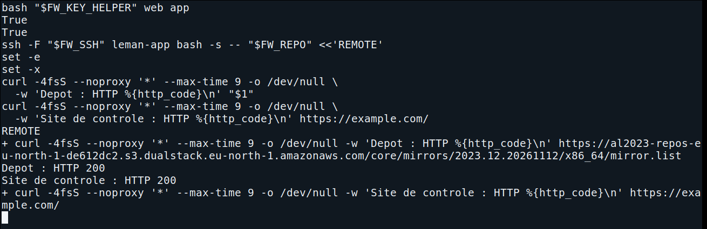

**CloudFormation bascule le NAT en deux mises à jour en réutilisant la même Elastic IP.**

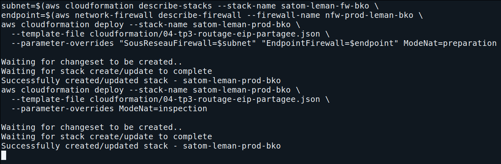

**La console affiche la route privée par défaut vers l’endpoint Network Firewall.**

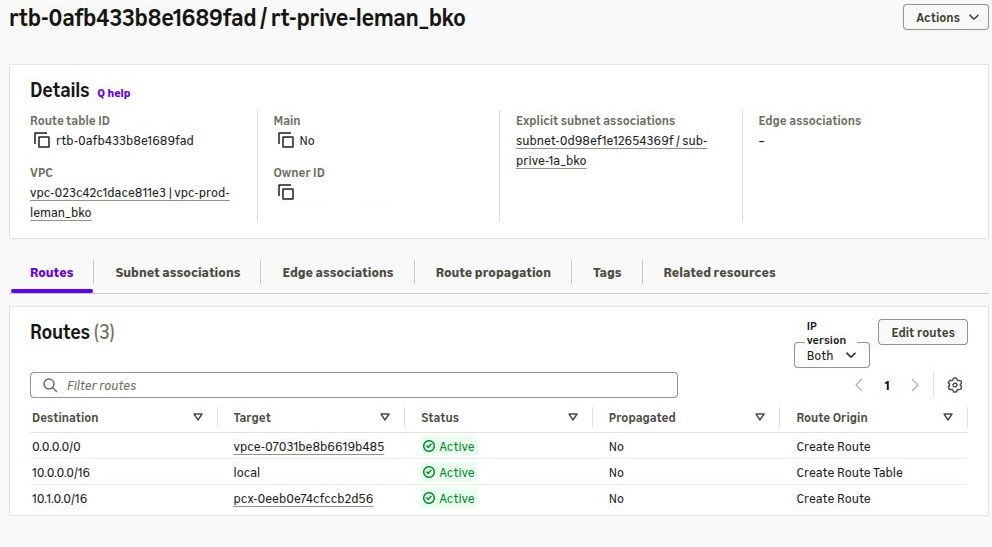

**Les tables montrent le chemin aller et la route de retour du NAT d’inspection vers le même endpoint.**

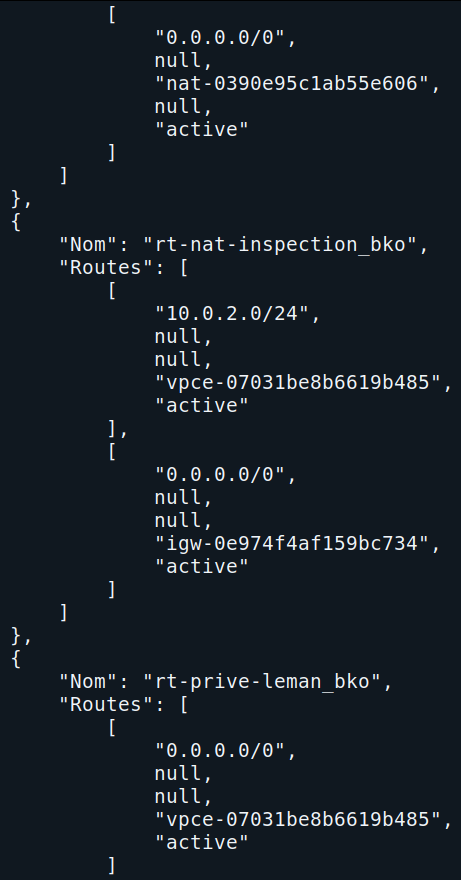

**Depuis app-01_bko, le dépôt Amazon Linux renvoie HTTP 200. La requête vers example.com expire avec le code curl 28.**

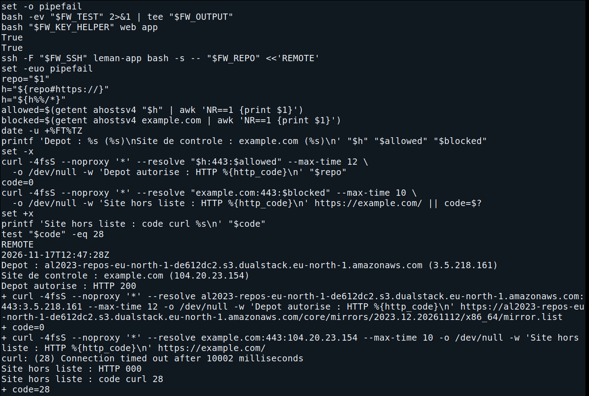

**CloudWatch enregistre l’alerte blocked pour la destination example.com et le flux vers le dépôt autorisé.**

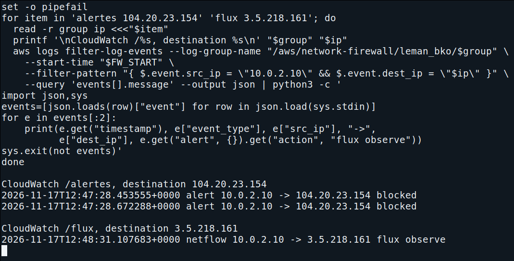

**CloudFormation rétablit la route privée active vers le NAT de référence.**

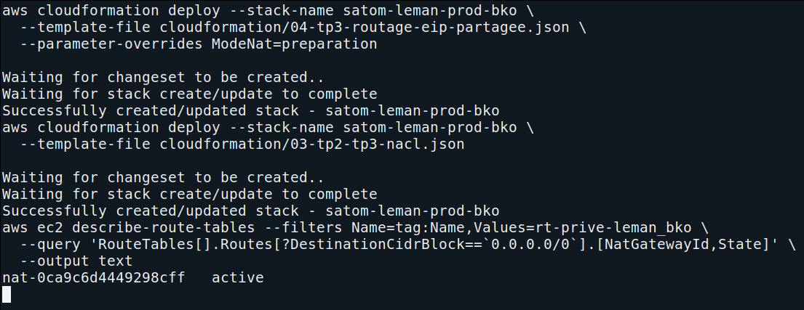

**Après restauration, le dépôt et le site de contrôle répondent à nouveau.** Les deux instances utilisées pour le test ont ensuite été arrêtées.

Les trois stacks temporaires sont en `DELETE_COMPLETE`. Le nettoyage supprime le pare-feu, les deux politiques, le groupe de règles, le sous-réseau dédié et les groupes de journaux CloudWatch du TP.

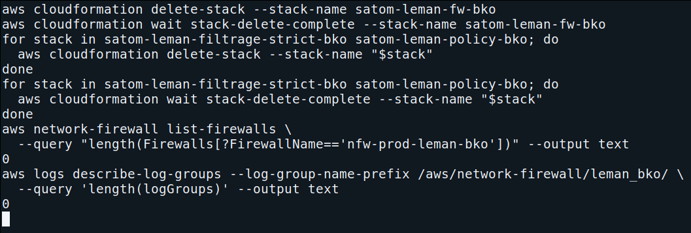

### Ressources de référence et coûts

Après le TP, le NAT Gateway de référence, les deux Elastic IP et trois volumes EBS gp3 de 8 Gio sont toujours provisionnés. Les trois instances EC2 sont arrêtées. Les deux IPv4 publiques coûtent ensemble environ 7,30 USD pour 730 heures au tarif public, hors crédits. Le NAT et les volumes EBS s’ajoutent à ce montant. Ce relevé est un inventaire des ressources du projet dans le compte partagé. [Tarifs VPC](https://aws.amazon.com/vpc/pricing/) et [tarifs EBS](https://aws.amazon.com/ebs/pricing/).

## Module 5 · VPC Peering

**Réalisé sur le compte d’origine à Stockholm.** Le peering relie le VPC de développement `10.1.0.0/16` au VPC de production `10.0.0.0/16`. Le groupe de développement autorise la sortie TCP 8080 vers `10.0.2.10`. Le groupe applicatif autorise ce port depuis `10.1.0.0/16`.

| Table | Destination | Cible |
|---|---|---|
| `rt-dev-leman_bko` | `10.0.0.0/16` | `pcx-lab_bko` |
| `rt-prive-leman_bko` | `10.1.0.0/16` | `pcx-lab_bko` |

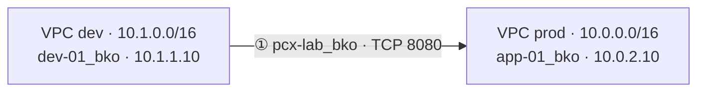

### TP 1 · VPC de développement

[Template CloudFormation](cloudformation/05-tp1-vpc-dev.json).

**CloudFormation crée la stack de développement à Stockholm.**

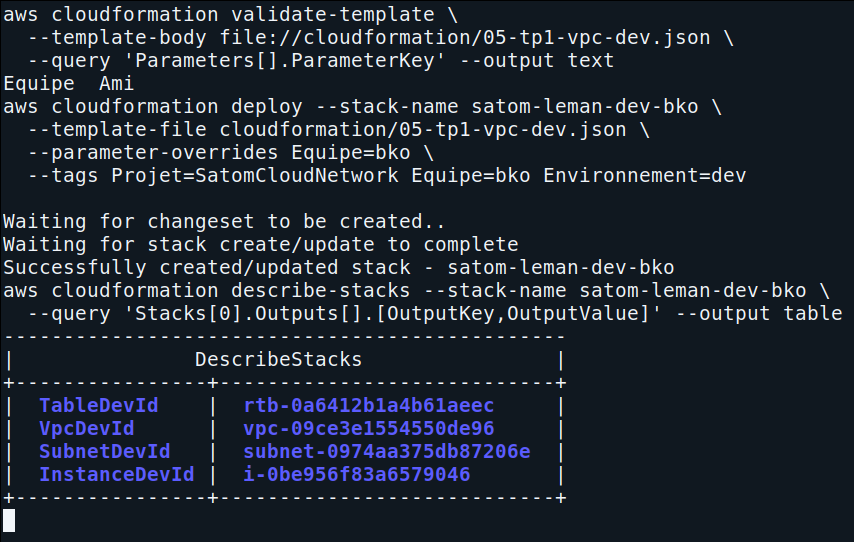

**Le VPC vpc-dev-leman_bko utilise le CIDR 10.1.0.0/16.**

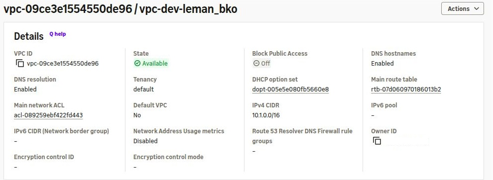

**Le sous-réseau sub-dev-1a_bko utilise 10.1.1.0/24.**

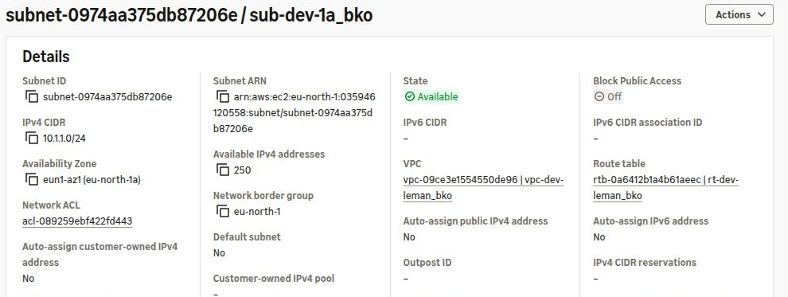

**dev-01_bko tourne avec l’IP privée 10.1.1.10.**

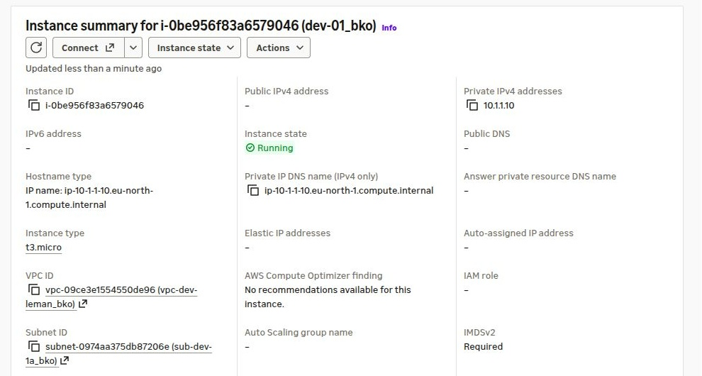

### TP 2 · Peering, routes et accès 8080

[Template CloudFormation](cloudformation/05-tp2-peering.json).

**CloudFormation met à jour la stack avec le peering, ses routes et l’autorisation TCP 8080.**

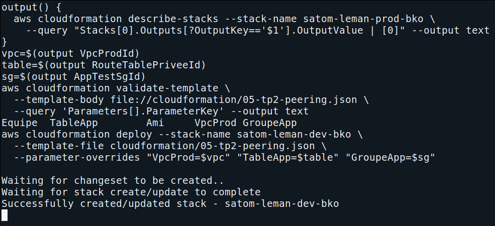

**La console AWS affiche pcx-lab_bko avec le statut Active.**

**Les routes vers la production et le développement sont actives. Le curl depuis dev-01_bko affiche la réponse du service app-01_bko.**

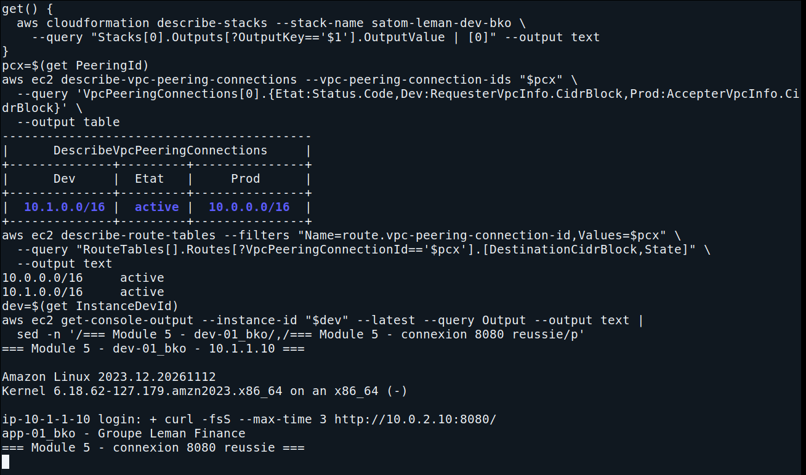

### TP 3 · Chevauchement et non-transitivité

[Template CloudFormation](cloudformation/05-tp3-non-transitivite.json).

Le [template de chevauchement](cloudformation/05-tp3-chevauchement.json) teste `10.0.128.0/17` face à `10.0.0.0/16`. Le message EC2 est générique et cite notamment le chevauchement. Les deux plages du test se recouvrent effectivement. Pour le deuxième test, le VPC tiers `10.2.0.0/16` possède un peering avec la production. Les deux sondes disposent d’une autorisation TCP 8080 vers la cible et la sonde de développement tente de passer par le peering dev–prod.

**EC2 indique que le peering de test est en état failed. CloudFormation confirme le rollback.**

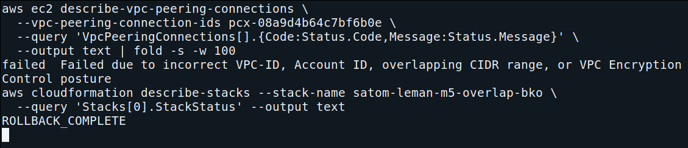

**CloudFormation déploie le VPC tiers et les sondes isolées pour le test de non-transitivité.**

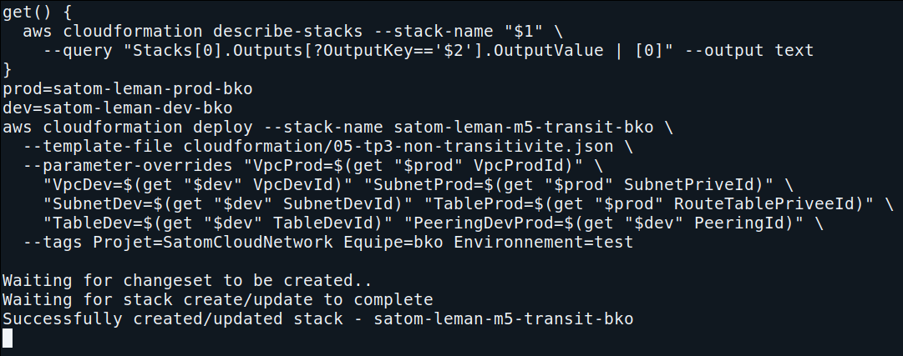

**La console affiche les peerings dev–prod et prod–tiers actifs, ainsi que le peering de chevauchement en échec.**

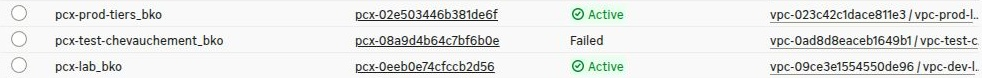

**La sonde prod joint le service tiers. La sonde dev joint app-01_bko, puis son curl vers le tiers expire avec le code 28.**

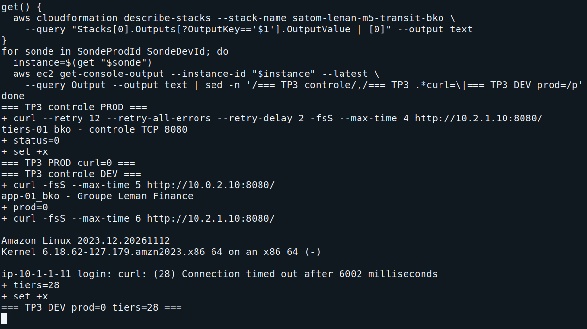

**La stack de non-transitivité et ses ressources sont supprimées. Les routes du peering dev–prod restent actives.**

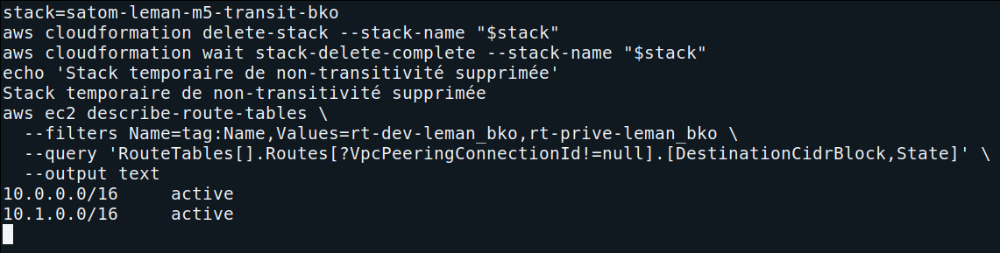

**Les trois instances principales du lab sont arrêtées en fin de module.**

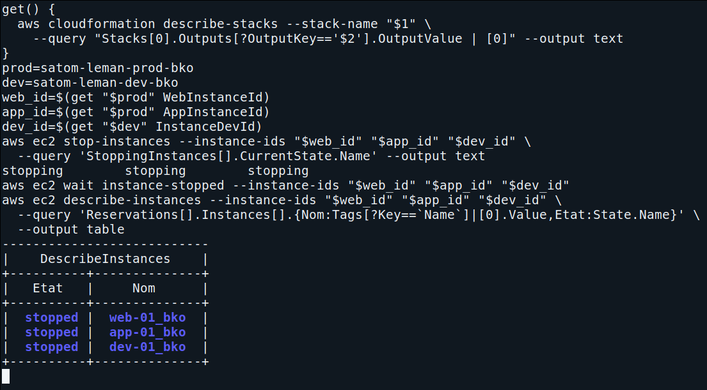

## Module 6 · Transit Gateway

**Déploiement et tests terminés à Stockholm.** Lors du premier essai, CloudFormation a tenté de créer `tgw-leman_bko`. Le test EC2 en mode `--dry-run` confirme que la SCP `p-yxwnli3w` refuse explicitement `ec2:CreateTransitGateway` au rôle du compte de lab. Le peering `pcx-lab_bko` est resté actif après le premier essai.

### Historique · Premier essai

[Template CloudFormation](cloudformation/06-tp1-transit-gateway.json). Il définit le TGW avec l’ASN 64512, les associations et propagations par défaut désactivées et un attachement par VPC.

**Tentative de déploiement.** Le terminal montre la commande CloudFormation et son échec.

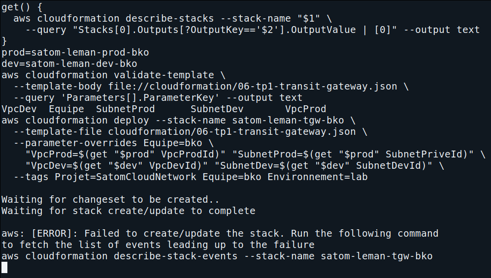

**Contrôle d’autorisation.** EC2 identifie l’action refusée et la politique de l’organisation.

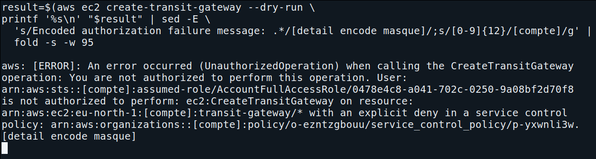

**Console AWS.** CloudFormation affiche le refus de création de la ressource TGW.

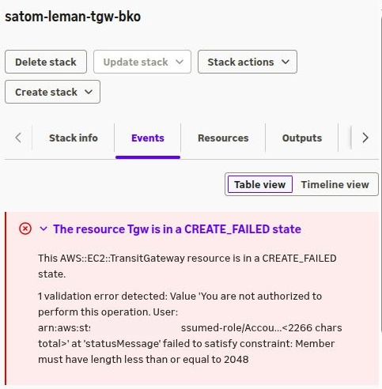

**État des ressources.** CloudFormation confirme ROLLBACK_COMPLETE. Aucun TGW de ce module n’est présent, et le peering existant reste actif.

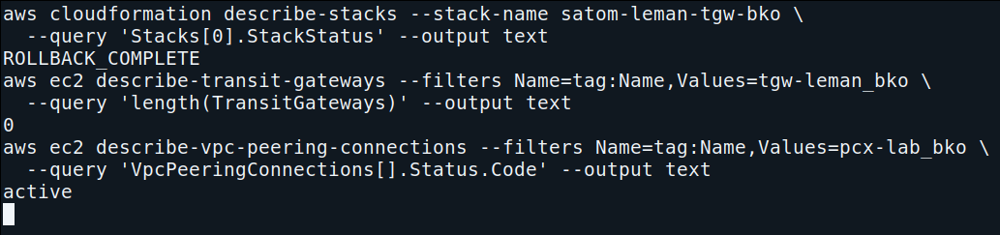

### TP 2 et TP 3 · Routage et diagnostic

Le [template de transition](cloudformation/06-transition-vpc-dev.json) retire le peering et ses deux routes après validation des attachements et conserve la règle TCP 8080 de l’application. Le [template du TGW](cloudformation/06-tp2-tp3-routes.json) ajoute les tables, les associations et la propagation croisée. Les deux templates ont été déployés après le rétablissement des droits.

| Table | Destination | Cible prévue |
|---|---|---|
| VPC production · `rt-prive-leman_bko` | `10.1.0.0/16` | `tgw-leman_bko` |
| VPC développement · `rt-dev-leman_bko` | `10.0.0.0/16` | `tgw-leman_bko` |
| TGW · `tgw-rt-prod_bko` | `10.1.0.0/16` | Propagation de `tgwa-dev_bko` |
| TGW · `tgw-rt-dev_bko` | `10.0.0.0/16` | Propagation de `tgwa-prod_bko` |

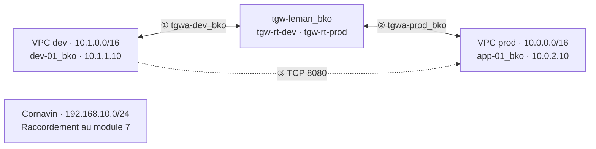

Après autorisation par l’école, déployer les attachements et vérifier leur état `available`. Appliquer ensuite la transition et déployer les routes TGW. Une fois `dev-01_bko` et `app-01_bko` démarrées, relever le résultat du curl depuis `dev-01_bko` sur la console série. Utiliser `RetourDev=non` pour retirer la propagation de retour, relever l’échec du curl, puis revenir à `RetourDev=oui` et confirmer le rétablissement.

Pour diagnostiquer l’asymétrie, vérifier dans l’ordre l’association de chaque attachement, la route propagée dans la table TGW, la route correspondante dans la table VPC et le groupe de sécurité de l’application. [Référence AWS sur les associations et propagations](https://docs.aws.amazon.com/AWSCloudFormation/latest/TemplateReference/aws-resource-ec2-transitgateway.html).

### Réalisation après rétablissement des accès

**CloudFormation crée la Transit Gateway avec l’association et la propagation par défaut désactivées.**

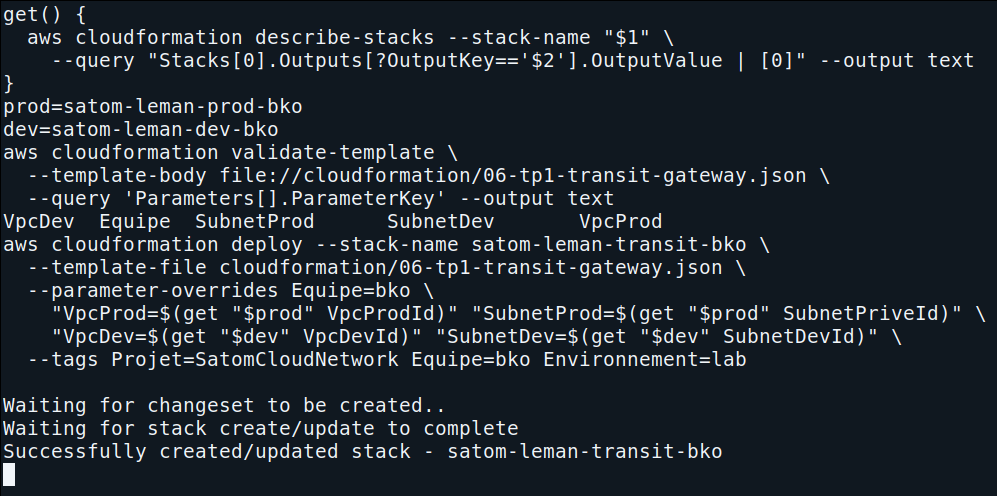

**Les attachements dev et prod apparaissent en état Available dans la console.**

**CloudFormation remplace le peering par la Transit Gateway et applique les routes VPC.**

**Les deux tables de transit affichent les routes propagées actives.**

**Après démarrage des instances, le curl depuis dev-01_bko reçoit la réponse d’app-01_bko sur TCP 8080.**

**CloudFormation retire temporairement la propagation de retour vers le développement.**

**Le dernier curl expire avec le code 28 quand la route de retour disparaît.**

**CloudFormation rétablit la propagation de retour.**

**Le dernier curl réussit de nouveau avec le code 0.**

**Les trois instances EC2 du projet sont confirmées arrêtées.**

Les deux attachements Transit Gateway restent disponibles pour le module 7. Ils sont facturés à l’heure même avec les EC2 arrêtées. [Tarification AWS Transit Gateway](https://aws.amazon.com/transit-gateway/pricing/).

## Module 7 · VPN Site-to-Site

### TP 1 · Connexions VPN et adresses des tunnels

Le [template des VPN](cloudformation/07-tp1-vpn.json) crée deux Customer Gateways et deux VPN à routes statiques, avec deux tunnels par site. Les adresses publiques imposées par le TP appartiennent aux plages TEST-NET. Les connexions sont provisionnées dans AWS et les quatre tunnels sont DOWN. La négociation IKE avec les points de terminaison AWS reste à valider avec des routeurs disposant d'adresses publiques joignables. CloudFormation demande le stockage natif des clés dans Secrets Manager. La vérification AWS confirme la présence d’une référence de secret pour chaque VPN. AWS gère le nom des secrets.

| Site | LAN | Adresse publique du scénario | CIDR internes des tunnels AWS |
| --- | --- | --- | --- |
| Siège Cornavin | `192.168.10.0/24` | `203.0.113.10` | `169.254.136.144/30`, `169.254.147.252/30` |
| Agence Lausanne | `192.168.20.0/24` | `198.51.100.20` | `169.254.61.236/30`, `169.254.230.192/30` |

**Déploiement CloudFormation des connexions et vérification des quatre tunnels AWS.**

### TP 2 et TP 3 · Routage, segmentation et redondance

Le [template de routage](cloudformation/07-tp2-tp3-routes.json) associe les deux connexions à une table Transit Gateway dédiée aux sites. Cette table dirige uniquement `10.0.2.10/32` vers la production. Les préfixes du siège et de l'agence sont ajoutés à la table TGW de production et à la table VPC du sous-réseau applicatif pour le retour. Le groupe de sécurité de l'application autorise TCP 8080 depuis les deux sites et ICMP depuis le siège pour le diagnostic. AWS affiche les deux routes de retour en `blackhole` tant que les tunnels sont DOWN. La table du développement contient la route vers la production et aucune route vers les sites.

**Déploiement du routage et lecture des tables TGW des sites, de la production et du développement.**

Les tests de trafic utilisent [un lab Linux isolé](modules/07-vpn/simulation/lab.py) avec des espaces réseau séparés et IPsec ESP AES-GCM via XFRM. Il reproduit le trajet de données avec des clés éphémères locales. Les instances AWS ne sont pas utilisées pour ces tests. Le siège atteint l'application en ICMP. Depuis l'agence, HTTP sur 8080 répond et TCP 8081 expire. Aucun des deux sites ne peut joindre l'adresse du développement dans le lab.

**Tests du siège et de l'agence, puis bascule du siège sur le second tunnel avec réponse au ping.**

1. Vérifier l'état et la télémétrie des deux tunnels côté AWS et côté routeur.
2. Comparer les paramètres IKE et ESP, les CIDR internes et la clé pré-partagée via Secrets Manager.
3. Suivre le trajet aller dans la table des sites et le retour dans les tables TGW et VPC de production.
4. Vérifier que le groupe de sécurité de l'application autorise le port et le CIDR source du test.

## Module 8 · Direct Connect

### TP 1 · Dimensionnement et association AWS

Pour transférer 2 To décimaux en 8 h, il faut en moyenne `16 000 Gbit ÷ 28 800 s = 0,556 Gbit/s`. Un port de 1 Gbit/s laisse environ 44,4 % de capacité nominale avant les surcharges et le trafic concurrent. Le site de colocation retenu est **Equinix ZRH51**, à Oberengstringen près de Zurich. Le port physique et la VIF de transit figurent dans l'architecture cible. Le TP n'a commandé aucun port. [Emplacements AWS Direct Connect](https://docs.aws.amazon.com/directconnect/latest/UserGuide/Colocation.html).

Le [template Direct Connect](cloudformation/08-tp1-dxgw.json) crée `dxgw-leman-bko` (ASN `64513`) et l'associe à la Transit Gateway avec les préfixes autorisés `10.0.0.0/16` et `192.168.10.0/24`. AWS renvoie respectivement `available` et `associated`.

**Déploiement du DXGW et vérification de son association et de ses préfixes.**

### TP 2 et TP 3 · BGP sur GRE et secours VPN

Le lab Linux utilise BIRD 2 pour établir une session BGP sur GRE et une seconde sur le VPN IPsec. Le siège annonce `192.168.10.0/24` et reçoit `10.0.0.0/16`. Le siège applique une `local-pref` de 200 sur GRE, contre 100 sur le secours. L'annonce du siège par le VPN ajoute trois occurrences de l'ASN `65010` à celle déjà présente. Les résultats ci-dessous concernent la simulation locale, qui remplace GNS3 dans ce rendu.

**Sessions BGP établies, préférence GRE et AS-path du secours observé côté AWS simulé.**

**Coupure administrative de GRE, bascule vers IPsec, puis retour automatique vers GRE.** La route du siège a changé en environ 0,01 s dans ce test local. Le ping lancé après chaque changement a reçu les deux réponses. Ce délai mesure un changement de route après une coupure administrative, avec les sessions et les timers du lab.

1. Vérifier que la session BGP est `Established` sur chaque liaison disponible.
2. Contrôler les préfixes annoncés par le siège et ceux reçus pour la production.
3. Vérifier la `local-pref` sur le routeur du siège et l'AS-path côté AWS ou sur son équivalent simulé.
4. Contrôler la route de retour vers `192.168.10.0/24` dans la table TGW de production et l'attachement qui la porte.

### Rejouer le lab et suivre les coûts

Le [script des modules 7 et 8](modules/07-vpn/simulation/lab.py) s'exécute sur Linux avec Python 3, iproute2, iputils, nftables, curl, BIRD 2 et le support TUN et XFRM. Exécuter `unshare -Urn python3 modules/07-vpn/simulation/lab.py /usr/sbin/bird "$(mktemp -d)"`. Les espaces réseau et les processus locaux sont arrêtés à la fin du script.

Après les vérifications, les stacks `satom-leman-sites-bko` et `satom-leman-vpn-bko` ont été supprimées dans cet ordre. AWS confirme qu’aucun des deux VPN du TP ne reste provisionné. Les templates permettent de recréer les VPN et leur routage au module 13. La Transit Gateway, le DXGW et son association sont conservés pour la suite. [Tarification AWS Site-to-Site VPN](https://aws.amazon.com/vpn/pricing/).

