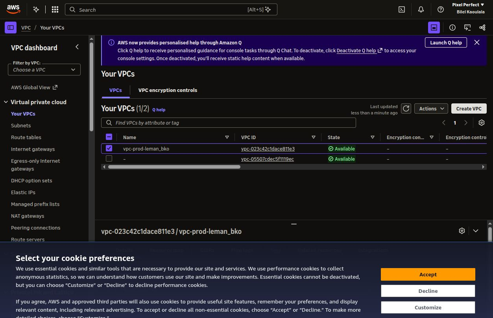

# Satom Cloud Network — Groupe Léman Finance

Projet du cours AWS E3. La région du lab est Stockholm (`eu-north-1`). Les ressources sont définies dans CloudFormation et les changements sont versionnés dans Git.

Les noms de ressources prennent le suffixe `_bko`. Pour les services dont le nom interdit le caractère souligné, utiliser `-bko`, comme pour la stack CloudFormation. Les tags obligatoires du cours gardent leurs valeurs, dont le nom exact de l’équipe.

## Module 1 — TP 1

Le [template](cloudformation/01-tp1-reseau.json) crée `vpc-prod-leman_bko` et les sous-réseaux `sub-public-1a_bko` et `sub-prive-1a_bko` en zone `eu-north-1a`. Il prend le nom de l'équipe en paramètre.

```bash
aws cloudformation deploy \
  --region eu-north-1 \
  --stack-name satom-leman-prod-bko \
  --template-file cloudformation/01-tp1-reseau.json \
  --parameter-overrides 'Equipe=NOM_DE_TON_EQUIPE' \
  --tags Projet=SatomCloudNetwork 'Equipe=NOM_DE_TON_EQUIPE' Environnement=prod
```

**Déployé le 16 novembre 2026.** La stack `satom-leman-prod-bko` est en `CREATE_COMPLETE`. Le VPC `vpc-prod-leman_bko` utilise le CIDR `10.0.0.0/16` et les tags `Projet=SatomCloudNetwork`, `Equipe=bko` et `Environnement=prod`.

| Sous-réseau | CIDR | Zone |
|---|---|---|
| `sub-public-1a_bko` | `10.0.1.0/24` | `eu-north-1a` |
| `sub-prive-1a_bko` | `10.0.2.0/24` | `eu-north-1a` |

La table de routage principale contient une seule entrée, `10.0.0.0/16 → local`.

### Captures de la console AWS





Les [résultats du terminal](modules/01-vpc/preuves/) complètent les captures.

## Étapes suivantes

| Étape | Changement à versionner | Preuve |
|---|---|---|
| Module 1, TP 2 et 3 | EC2 avec adresses privées fixes et définition temporaire du test de chevauchement | Ping interne, absence de sortie Internet, conflit CIDR |
| Module 2 | Passerelle Internet, NAT et tables de routage | Routes et tests de sortie avant retrait, pendant retrait et après rétablissement |
| Module 3 | Groupes de sécurité et NACL | Tests HTTPS et 8080, tests de blocage et règles rétablies |
| Module 4 | Network Firewall, routes symétriques et CloudWatch Logs | Pare-feu prêt, trafic autorisé et bloqué, journaux et nettoyage |

Les captures documentent les états déployés et les tests. Les modifications temporaires des routes et des règles passent aussi par CloudFormation.
