# Satom Cloud Network — Groupe Léman Finance

Projet du cours AWS E3. La région du lab est Stockholm (`eu-north-1`). Les ressources sont définies dans CloudFormation et les changements sont versionnés dans Git.

Les noms de ressources prennent le suffixe `_bko`. Pour les services dont le nom interdit le caractère souligné, utiliser `-bko`, comme pour la stack CloudFormation. Les tags obligatoires du cours gardent leurs valeurs, dont le nom exact de l’équipe.

## Module 1 — TP 1

Le [template](cloudformation/01-tp1-reseau.json) crée `vpc-prod-leman_bko` et les sous-réseaux `sub-public-1a_bko` et `sub-prive-1a_bko` en zone `eu-north-1a`. Il prend le nom de l'équipe en paramètre.

**Déployé le 16 novembre 2026.** La stack `satom-leman-prod-bko` est en `CREATE_COMPLETE`. Le VPC `vpc-prod-leman_bko` utilise le CIDR `10.0.0.0/16` et les tags `Projet=SatomCloudNetwork`, `Equipe=bko` et `Environnement=prod`.

| Sous-réseau | CIDR | Zone |
|---|---|---|
| `sub-public-1a_bko` | `10.0.1.0/24` | `eu-north-1a` |
| `sub-prive-1a_bko` | `10.0.2.0/24` | `eu-north-1a` |

La table de routage principale contient une seule entrée, `10.0.0.0/16 → local`.

### Réalisation du TP 1 en captures

**1.** CloudFormation valide le template à Stockholm et reconnaît le paramètre d’équipe.

**2.** La commande de déploiement est relancée. CloudFormation confirme que la stack est déjà à jour.

**3.** La console CloudFormation affiche la stack en CREATE_COMPLETE.

**4.** La console VPC affiche le réseau de production vpc-prod-leman_bko.

**5.** Les deux sous-réseaux sont disponibles avec leurs plages IP respectives.

**6.** La table principale contient uniquement la route locale 10.0.0.0/16.

## Module 1 — TP 2 · Instances et connectivité

[Template CloudFormation](cloudformation/01-tp2-instances.json). Les instances utilisent les adresses privées `10.0.1.10` et `10.0.2.10`. Le script de démarrage exécute les pings sur les instances et les sorties sont lues depuis la console série EC2.

**1.** Validation du template et mise à jour de la stack pour ajouter les deux instances.

**2.** La console EC2 montre web-01_bko et app-01_bko en cours d’exécution dans eu-north-1a.

**3.** Depuis web-01_bko, le ping vers 10.0.2.10 reçoit quatre réponses sur quatre.

**4.** Depuis app-01_bko, le ping vers 8.8.8.8 ne reçoit aucune réponse avant l’ajout du routage Internet.

## Module 1 — TP 3 · Plan d’adressage et chevauchement

Le [template de test](cloudformation/01-tp3-chevauchement.json) tente de créer le bloc `10.0.1.128/25` dans le VPC de production depuis une stack dédiée. AWS renvoie `CREATE_FAILED` avec le motif « conflicts with another subnet ». Le bloc testé est inclus dans `10.0.1.0/24`.

| Périmètre | Bloc IPv4 | Zone | Affectation |
|---|---|---|---|
| `vpc-prod-leman_bko` | `10.0.0.0/16` | Stockholm | Production |
| `sub-public-1a_bko` | `10.0.1.0/24` | `eu-north-1a` | `web-01_bko` à `10.0.1.10` |
| `sub-prive-1a_bko` | `10.0.2.0/24` | `eu-north-1a` | `app-01_bko` à `10.0.2.10` |
| Sous-réseau données | `10.0.3.0/24` | `eu-north-1a` prévue | Réservé dans le plan |
| VPC développement | `10.1.0.0/16` | Stockholm | Réservé pour le module 5 |

Le sous-réseau privé offre **251 adresses attribuables**. Un `/24` contient 256 adresses, dont 5 sont réservées par AWS. La plage attribuable va de `10.0.2.4` à `10.0.2.254`. L’adresse de broadcast théorique est `10.0.2.255`, réservée par AWS. Le `/24` laisse de la place pour ajouter des instances et le plan garde des blocs distincts pour les autres usages du lab. Le plan est prêt pour la validation de l’Architecte réseau.

**1.** Le terminal montre la tentative de déploiement et le motif du refus remonté par CloudFormation.

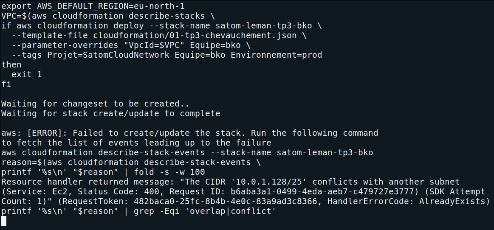

**2.** L’onglet Events de CloudFormation affiche le refus de créer `SubnetChevauchant`.

**3.** Le terminal confirme que le VPC contient les deux sous-réseaux prévus.

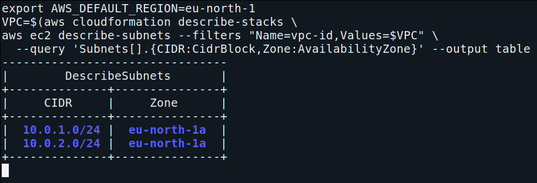

## Module 2 — TP 1 · Routage public

[Template CloudFormation](cloudformation/02-tp1-routage-public.json). La passerelle `igw-prod-leman_bko` est attachée au VPC de production. Une Elastic IP est associée à `web-01_bko`. Le test utilise EC2 Instance Connect avec une clé temporaire et un accès SSH limité à l’IPv4 du poste.

**1.** Validation du template puis mise à jour de la stack CloudFormation.

**2.** La console VPC affiche l’association de `rt-public-leman_bko` à `sub-public-1a_bko` et la route active `0.0.0.0/0` vers la passerelle Internet.

**3.** Le poste rejoint `web-01_bko` en SSH via son IP publique. Depuis cette instance, le ping vers `8.8.8.8` reçoit quatre réponses sur quatre.

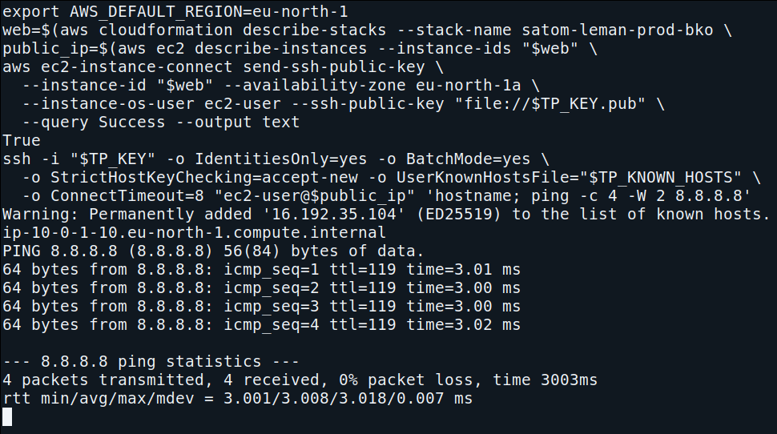

## Module 2 — TP 2 · Routage privé et NAT

[Template CloudFormation](cloudformation/02-tp2-routage-prive.json). La NAT Gateway est dans le sous-réseau public. La table du sous-réseau privé envoie le trafic Internet vers cette passerelle. Le SSH de test vers app-01_bko est limité au groupe de sécurité de web-01_bko.

**1.** Validation et déploiement CloudFormation du NAT et de la table privée.

**2.** La console VPC confirme l’association à sub-prive-1a_bko et la route active 0.0.0.0/0 vers le NAT.

**3.** Le test lancé sur app-01_bko via le relais SSH web-01_bko reçoit quatre réponses sur quatre depuis 8.8.8.8.

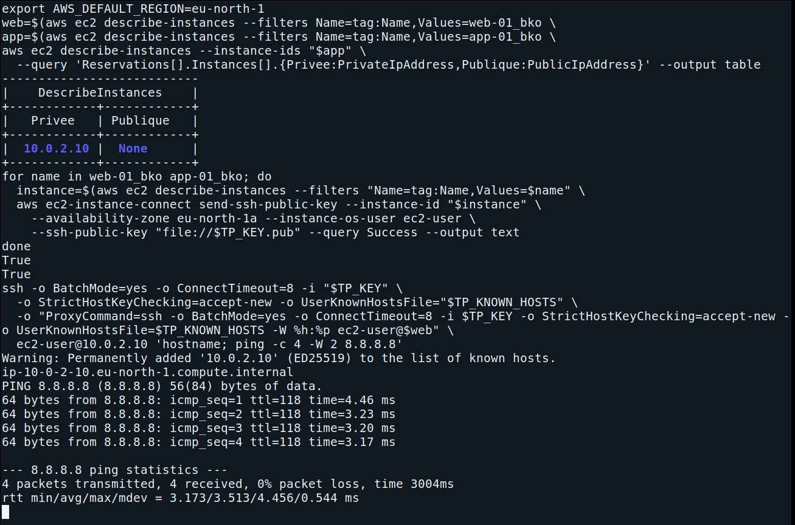

**4.** app-01_bko ne possède pas d’IP publique. Une tentative SSH depuis le poste vers l’IP publique du NAT expire.

## Module 2 — TP 3 · Diagnostic d’une route manquante

[Template CloudFormation](cloudformation/02-tp2-routage-prive.json). Le paramètre RoutePriveeActive pilote la route privée. Le test du TP 2 sert de référence avant le retrait.

**1.** CloudFormation retire temporairement la route par défaut avec RoutePriveeActive=non.

**2.** La table privée reste liée à sub-prive-1a_bko et affiche uniquement la route locale.

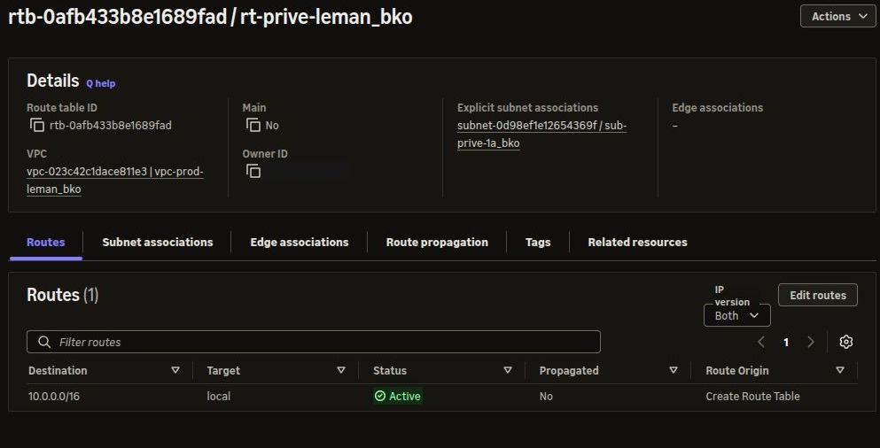

**3.** Sans route par défaut, le ping depuis app-01_bko vers 8.8.8.8 perd les quatre paquets.

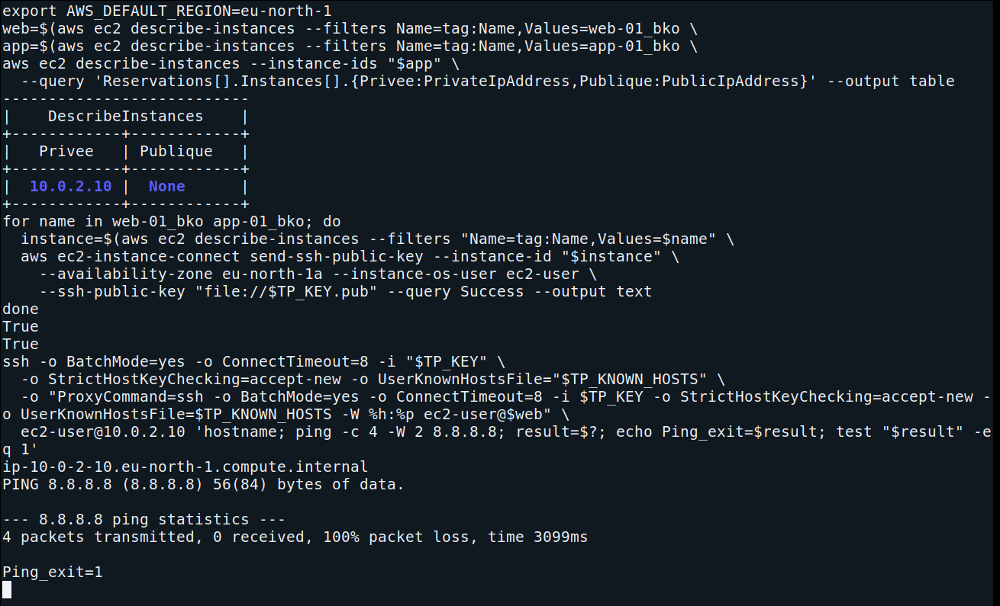

**4.** CloudFormation recrée la route par défaut avec RoutePriveeActive=oui.

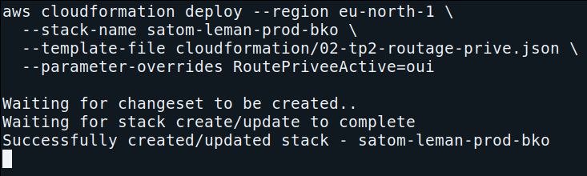

**5.** La console affiche de nouveau la route par défaut active vers la NAT Gateway.

**6.** Après rétablissement, app-01_bko reçoit quatre réponses sur quatre.

### Procédure de diagnostic

1. Vérifier la table associée au sous-réseau. Le [sous-réseau public](modules/02-routage/tp1/02-route-publique.jpg) utilise `rt-public-leman_bko`. Le sous-réseau privé utilise `rt-prive-leman_bko`.
2. Dans la table concernée, vérifier la présence de `0.0.0.0/0`.
3. Vérifier que la route pointe vers la bonne cible. La table privée utilise le NAT et la table publique utilise la passerelle Internet.
4. Confirmer que la route est active et que sa cible est disponible. Refaire le ping pour valider le rétablissement.

La procédure est prête pour la validation du responsable qualité.

## Module 3 · Security Groups et NACL

### TP 1 · Groupes de sécurité

sg-web_bko autorise TCP 443 depuis Internet et TCP 22 depuis l’IPv4 du poste de test, utilisée pour représenter la salle Cornavin. sg-app_bko autorise TCP 22 et 8080 depuis sg-web_bko. L’application garde son IP privée 10.0.2.10. Le certificat de lab est vérifié avec curl.

[Template CloudFormation](cloudformation/03-tp1-security-groups.json).

**Validation et déploiement des groupes de sécurité par CloudFormation.**

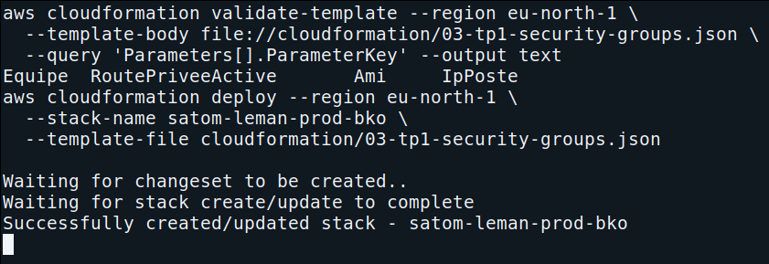

**Règles du groupe web dans la console EC2.**

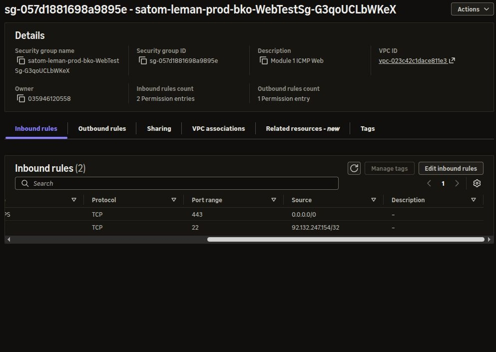

**Règles du groupe applicatif avec le groupe web comme source.**

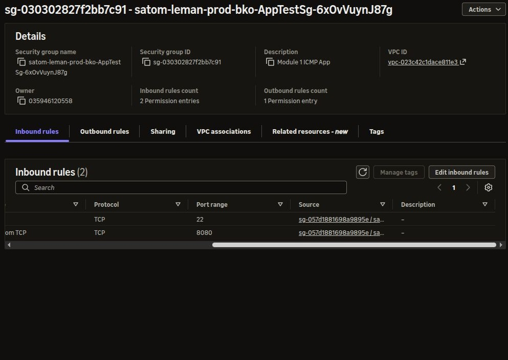

**Installation des deux services de démonstration avec le script versionné.**

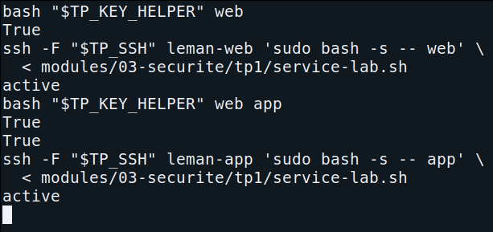

**Le HTTPS public répond et le serveur web atteint l’application sur le port 8080. L’instance applicative n’a pas d’IP publique.**

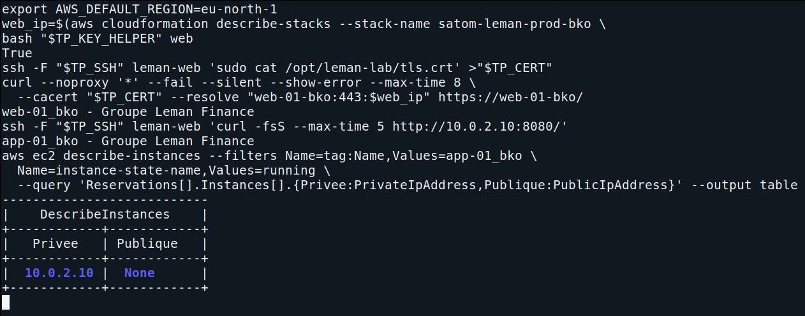

### TP 2 · Retour de trafic et NACL

Un groupe de sécurité mémorise les connexions autorisées. Une NACL évalue indépendamment les deux sens. Le test HTTPS est lancé depuis app-01_bko vers l’IP privée de web-01_bko pour tester la règle de retour sans utiliser l’exception de retour SSH du poste.

[Template CloudFormation](cloudformation/03-tp2-tp3-nacl.json).

**CloudFormation crée la NACL et l’associe au sous-réseau public.**

**La règle entrante 100 autorise le port 443.**

**La règle sortante 100 autorise les ports de retour 1024 à 65535.**

**L’appel HTTPS aboutit avec les règles de référence.**

**Le paramètre RetourHttps=non retire la règle sortante 100.**

**L’onglet sortant montre la NACL sans la règle 100.**

**Le même appel HTTPS expire avec le code curl 28.**

**CloudFormation rétablit la règle de retour.**

### TP 3 · Diagnostic d’un blocage

Les règles NACL sont examinées par numéro croissant. La première règle qui correspond décide du sort du paquet. Le refus 90 prend donc effet avant l’autorisation 100.

[Template CloudFormation](cloudformation/03-tp2-tp3-nacl.json).

**CloudFormation retire l’autorisation 8080 de sg-app_bko.**

**L’appel de web-01_bko vers app-01_bko:8080 expire.**

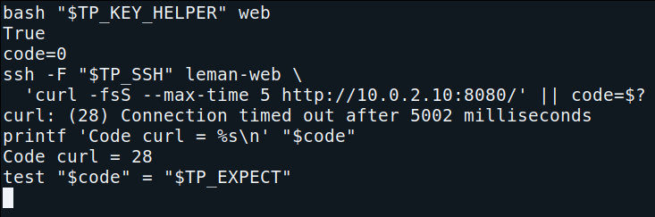

**CloudFormation rétablit le port applicatif et ajoute le refus HTTPS numéro 90.**

**Dans la console, le refus HTTPS 90 apparaît avant l’autorisation 100.**

**Le test HTTPS expire avec le refus prioritaire actif.**

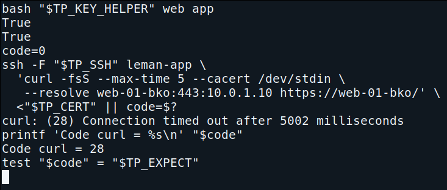

**La configuration de référence est rétablie dans CloudFormation.**

**Le serveur web atteint de nouveau l’application sur 8080.**

**L’appel HTTPS réussit de nouveau.**

### Diagnostic

1. Identifier le groupe attaché à l’interface de la cible.
2. Vérifier le protocole, le port et la source autorisée dans les règles du groupe.
3. Examiner les NACL des sous-réseaux traversés dans les deux sens. Comparer les numéros des règles et vérifier les ports de retour.
4. Confirmer la route vers la destination, puis relancer le test applicatif.

### Schéma du filtrage

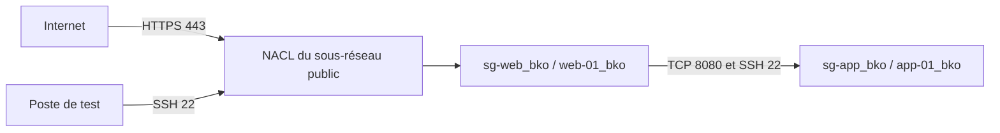

## Module 4 · Network Firewall

**État du module · bloqué par la politique de l’organisation AWS.** Le compte de l’école refuse explicitement `network-firewall:CreateFirewallPolicy` à Stockholm. Le test a été fait dans la stack séparée `satom-leman-nfw-bko`, qui a terminé en `ROLLBACK_COMPLETE`. Aucun endpoint de pare-feu n’a été créé.

### TP 1 · Tentative de déploiement

Le [template CloudFormation](cloudformation/04-tp1-network-firewall.json) prévoit le sous-réseau dédié `sub-fw-1a_bko` (`10.0.4.0/28`), la politique et le pare-feu. Les identifiants de compte ont été masqués dans les captures du refus.

**1.** Le terminal montre la validation CloudFormation, la tentative de déploiement et le refus de l’opération de création de politique.

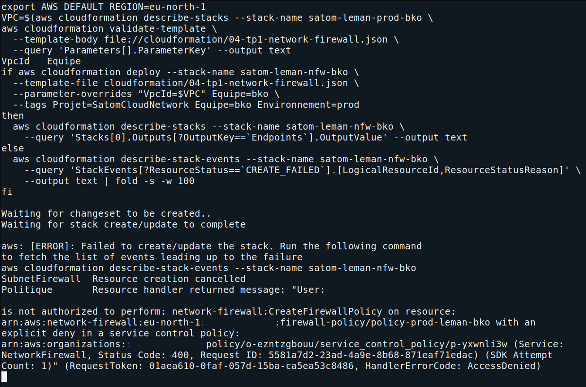

**2.** La console CloudFormation montre la ressource Politique en CREATE_FAILED.

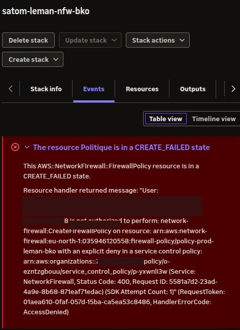

**3.** Le retour arrière est terminé. Aucun sous-réseau `10.0.4.0/28` ne reste dans le VPC, et la route privée par défaut est toujours active vers le NAT du module 2.

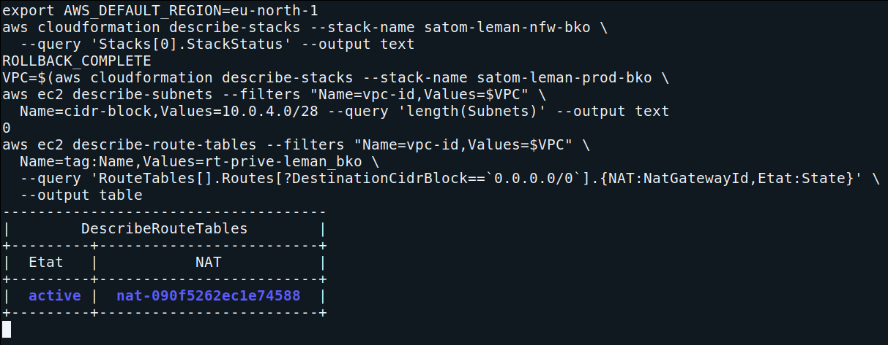

### TP 2 et TP 3 · Préparés, en attente d’un compte autorisé

Le [template de filtrage et de journalisation](cloudformation/04-tp2-regles-journaux.json) prend les domaines approuvés en paramètre. Il prévoit la liste blanche HTTP et HTTPS et la livraison des alertes et flux dans CloudWatch Logs. Le [template de routage](cloudformation/04-tp3-routage-inspection.json) prend en paramètre le sous-réseau et l’endpoint du pare-feu. CloudFormation a validé les deux fichiers. Leur déploiement et les tests de trafic restent à réaliser.

| Table | Destination | Cible prévue pendant le test |
|---|---|---|
| Privée applicative | `0.0.0.0/0` | Endpoint du pare-feu |
| Sous-réseau du pare-feu | `0.0.0.0/0` | NAT d’inspection temporaire |
| Sous-réseau du NAT d’inspection | `0.0.0.0/0` | Passerelle Internet |
| Sous-réseau du NAT d’inspection | `10.0.2.0/24` | Même endpoint pour le retour |

Le NAT d’inspection utilise le sous-réseau séparé `10.0.5.0/28`. Sa route retour permet de faire passer les deux sens par le même pare-feu sans modifier la table du serveur web. [Documentation AWS sur le retour symétrique](https://docs.aws.amazon.com/transform/latest/userguide/vpc-webapp-access.html).

Pour reprendre le lab, faire autoriser Network Firewall par l’école, faire confirmer les domaines de mises à jour approuvés, puis redéployer la stack de test après suppression de la stack en rollback. Quand l’endpoint est prêt, appliquer le template de routage depuis la stack de production. Depuis `app-01_bko`, tester un dépôt approuvé puis un autre domaine, relever les résultats et les corréler aux journaux. Après les captures, réappliquer le template du module 3 avec ses paramètres de référence pour rétablir le NAT initial et retirer le NAT temporaire. Supprimer ensuite la stack du pare-feu.
