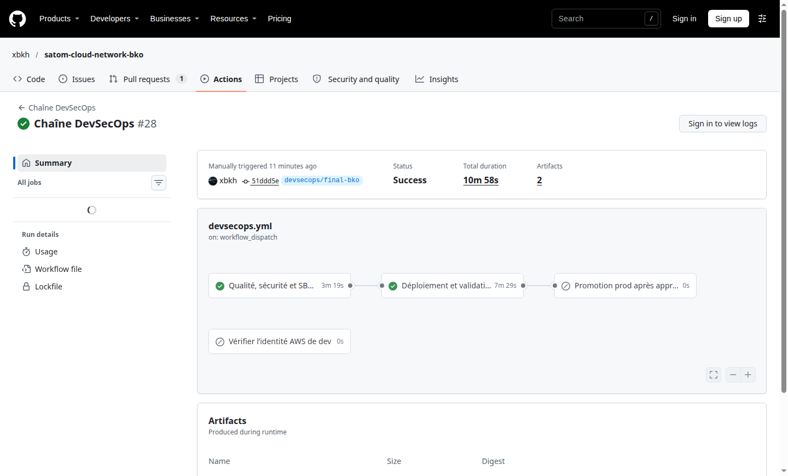
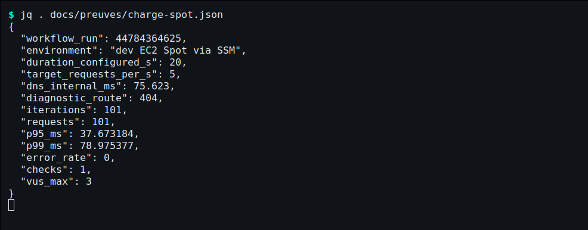
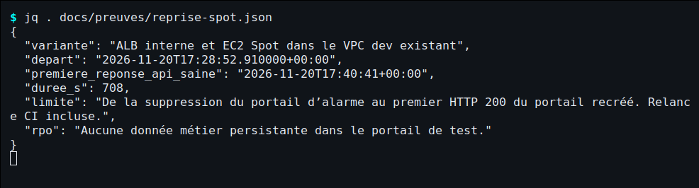
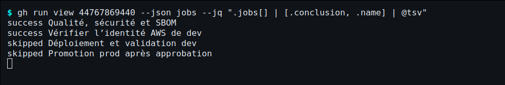
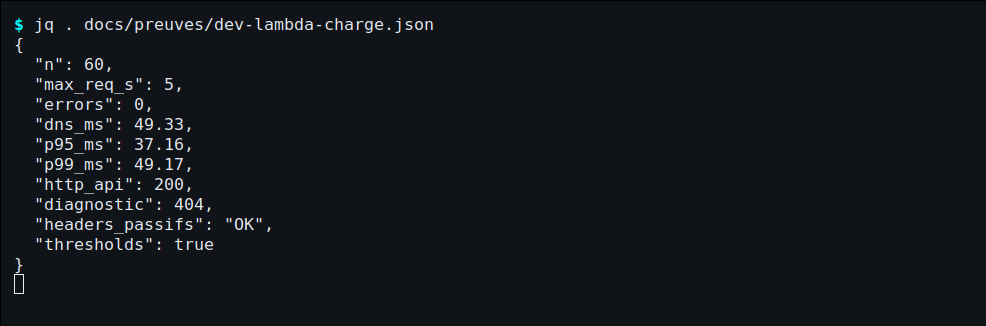
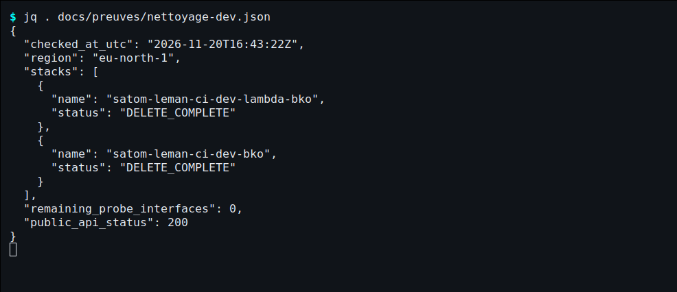
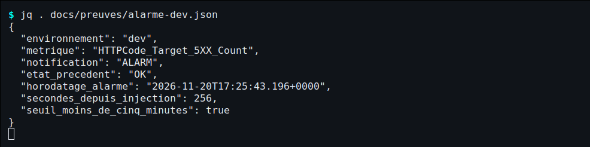
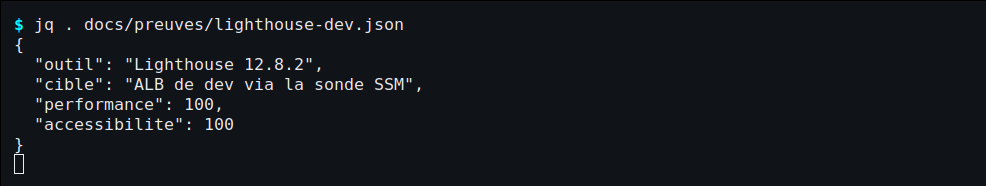

# Validation du TP final

[Énoncé du TP final](https://hackmd.io/@Formateur/rJOiAHwCMg) · [Journal des sprints](journal.md) · [Décisions d’architecture](adr/) · [Runbook](runbook.md) · [Rapport de synthèse](rapport-final.pdf)

| Exigence | Preuve et état |
| --- | --- |
| Templates et paramètres séparés | `cfn-lint`, `cfn-guard`, contrôle du plan CIDR et du code embarqué. Les templates historiques restent dans `cloudformation/`. |
| Qualité SonarQube | 10 tests au total. Quality gate passé, couverture 96,1 %, 0 critique et 0 point sensible. [Export](preuves/sonarqube.json) |
| Analyse statique | Gitleaks sur l’historique, Semgrep sur le code de l’application et pip-audit sur les dépendances du portail. Les deux faux positifs de la première exécution sont justifiés par leur empreinte exacte dans `.gitleaksignore`. |
| SBOM | [Inventaire CycloneDX](../sbom/portail.cdx.json). Les fonctions du portail utilisent la bibliothèque standard de Python. |
| GitHub Actions et OIDC | [Exécution GitHub](https://github.com/xbkh/satom-cloud-network-bko/actions/runs/44784364625). Les contrôles et la session AWS temporaire ont permis le déploiement de dev, la vérification par la sonde SSM et la charge k6. IAM Access Analyzer a retourné zéro remarque pour la politique d’identité du rôle GitHub dev. |
| Gouvernance | `main` impose une pull request, une vérification et une revue. L’environnement GitHub `prod` interdit l’auto-approbation. Le compte actuel est le seul collaborateur visible du dépôt. L’accès au dépôt de rendu `Morrad-Satom-IT/satom-leman-portail` reste à ouvrir. |
| Déploiement EC2 | Plafond de 48 vCPU à la demande atteint. Le quota distinct Spot a permis de lancer les trois cibles et la sonde dans le VPC dev de référence. Le contrôle DNS a été corrigé après le premier essai pour accepter les majuscules dans le nom généré par AWS. [Relevé Spot](preuves/quota-spot.json) |
| Charge dev | **101 requêtes, 0 erreur**, latences p95 de 37,67 ms et p99 de 78,98 ms, DNS interne de 75,62 ms. CloudWatch mesure au plus 2,05 ms en p95 et 2,48 ms en p99 sur les deux points d’une minute pour les cibles de l’ALB. [k6](preuves/charge-spot.json) · [CloudWatch](preuves/cloudwatch-spot.json) · [Essai Lambda antérieur](preuves/dev-lambda-charge.json) |
| Reprise dev | Retour de l’API sur EC2 Spot en **11 min 48 s** après début de suppression de la stack du lab d’alarme, avec relance GitHub comprise. La variante Lambda précédente prenait 27 min 17 s. Le portail de test ne stocke aucune donnée métier. [Reprise Spot](preuves/reprise-spot.json) · [Reprise Lambda](preuves/reprise-dev.json) |
| Contrôle HTTP | Audit ZAP passif via la sonde SSM sur l’accueil HTML, l’API et l’image. Le premier test avait relevé deux alertes faibles, une adresse privée et la version du serveur. Le second test a constaté **zéro alerte** sur les trois réponses après correction. [Avant](preuves/zap-dev-avant.json) · [Après](preuves/zap-dev-apres.json) |
| Monitoring | L’alarme de dev basée sur les erreurs réelles de la cible ALB a émis une notification SNS reçue dans SQS **4 min 16 s** après le lancement des requêtes de test. La variante Lambda avait aussi consigné 64 événements JSON avec X-Ray actif sur la fonction. La trace distribuée reste à qualifier. [Notification 5xx](preuves/alarme-dev.json) |
| Conformité et coûts | Aucun abonnement Security Hub, enregistreur AWS Config ou détecteur GuardDuty dans Stockholm. Aucun budget du projet détecté. Le modèle d’alerte à 80 % passe le contrôle local. Une politique AWS Organizations refuse sa validation CloudFormation dans `us-east-1`. Les tags de facturation, le score CIS, les règles Config et le chiffrement KMS restent à qualifier. |
| Connectivité des bureaux | Les VPN AWS à adresses de documentation sont restés DOWN. Bascule et retour testés dans la maquette IPsec/BGP. Les résultats physiques requièrent des routeurs et des adresses autorisés. |
| DNS et edge | Accueil, API et image répondent en HTTPS. Première résolution DNS externe de 54,45 ms. Cache confirmé sur l’image. Zone publique non signée, WAF et OAC absents, aucune donnée `CacheHitRate` sur les 30 jours interrogés. [Contrôle du portail](preuves/portail-public.json) |
| Lighthouse | 100 en performance et 100 en accessibilité sur l’accueil HTML via SSM et à la médiane de trois audits en CI. Le portail public historique sert toujours la version texte. [Scores CI](preuves/lighthouse.json) · [Scores AWS](preuves/lighthouse-dev.json) |
| Cache ponctuel | 10 réponses issues du cache sur 10 requêtes HEAD de l’image publique. La série CloudWatch `CacheHitRate` reste à collecter après autorisation d’activer la métrique. [Échantillon](preuves/cache-ponctuel.json) |

**Coûts existants.** Le NAT de référence `nat-prod-leman_bko` et deux attachements Transit Gateway `tgwa-dev_bko` et `tgwa-prod_bko` sont encore disponibles dans le compte. Ils étaient présents avant ce TP final et peuvent générer des frais horaires. La facturation exacte demande l’accès au suivi des coûts par équipe.

**Durcissement préparé.** Les modèles IaC couvrent le WAF en observation, DNSSEC, l’association KMS pour les journaux, l’origine S3 privée avec OAC et la métrique de cache. Leur qualification dans l’environnement officiel reste ouverte. [Procédure de qualification](runbook.md#qualifier-les-protections-du-portail)

## Points de passage du cahier des charges

| Gate | État |
| --- | --- |
| G0 · Mise en place | Dépôt, protection de branche et OIDC prêts. Budget par équipe et accès au dépôt du formateur à confirmer. |
| G1 · Réseau et code | Preuves réseau des modules 1 à 3, quality gate et recherche de secrets réussis. |
| G2 · Routage et interconnexion | Preuves des modules 4 à 8 et décisions versionnées. Tunnels physiques à qualifier. |
| G3 · Portail et performance | Portail public vérifié. Charge k6, audit ZAP passif ciblé, Lighthouse et résolution DNS mesurés. Série de cache et disponibilité à qualifier dans la durée. |
| G4 · Exploitation | Notification SNS reçue sous cinq minutes dans le lab EC2 Spot. Score CIS à valider. |
| G5 · Livraison | Reprise EC2 Spot chronométrée et preuve de nettoyage publiée. Revue indépendante et promotion prod attendues. |

## Captures de vérification

L’exécution manuelle GitHub confirme les contrôles de qualité et le déploiement automatisé de dev.

Le rapport k6 provient de la commande exécutée sur la sonde dans le VPC.

La première réponse saine après recréation et la suppression des stacks de l’essai sont consignées. [Nettoyage Spot](preuves/nettoyage-spot.json)

L’exécution initiale GitHub confirme les contrôles de qualité et l’obtention de la session OIDC de dev.

Le rapport de la sonde interne contient le débit réel, les percentiles de latence, le résultat du contrôle des en-têtes et le code de retour de la route de diagnostic.

La preuve de reprise donne les heures de départ et de retour du service, ainsi que les réponses vues par la sonde interne.

CloudFormation a confirmé la suppression des deux stacks temporaires après le test. La sonde ne laisse aucune interface réseau et le portail public répondait en HTTPS lors du contrôle suivant. [Résultat du nettoyage](preuves/nettoyage-dev.json)

La réception SQS confirme l’alerte pour les réponses 5xx réellement émises par la cible du lab.

Lighthouse a chargé l’accueil HTML via l’ALB privé et la sonde SSM.

## Séquence de démonstration

1. **0 à 3 min.** Ouvrir la page d’accueil, `/api/health` et l’image sur le [portail](https://portail.bilelk.com/).
2. **3 à 6 min.** Présenter le change set, la pull request, les artefacts de qualité et la preuve OIDC dev.
3. **6 à 11 min.** Montrer le chronométrage EC2 Spot, puis présenter la mesure k6 et le second audit passif. Préparer le lab avant la présentation pour pouvoir lancer la sonde dans le créneau.
4. **11 à 15 min.** Montrer l’alarme CloudWatch, le message reçu via SNS et les écarts qui nécessitent le compte de gestion. [Captures du module 12](../modules/12-supervision/)
