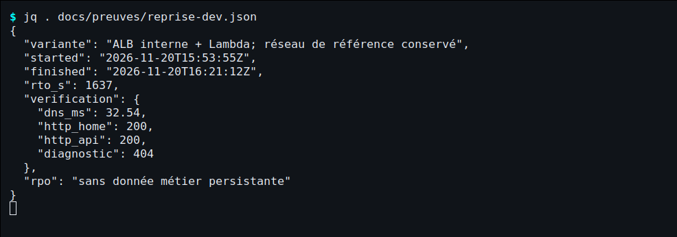

# Validation du TP final

[Énoncé du TP final](https://hackmd.io/@Formateur/rJOiAHwCMg) · [Journal des sprints](journal.md) · [Décisions d’architecture](adr/) · [Runbook](runbook.md) · [Rapport de synthèse](rapport-final.pdf)

| Exigence | Preuve et état |
| --- | --- |
| Templates et paramètres séparés | `cfn-lint`, `cfn-guard`, contrôle du plan CIDR et du code embarqué. Les templates historiques restent dans `cloudformation/`. |
| Qualité SonarQube | 8 tests au total. Quality gate passé, couverture 94,4 %, 0 duplication, 0 critique et 0 point sensible. [Export](preuves/sonarqube.json) |
| Analyse statique | Gitleaks sur l’historique, Semgrep sur le code de l’application et pip-audit sur les dépendances du portail. Les deux faux positifs de la première exécution sont justifiés par leur empreinte exacte dans `.gitleaksignore`. |
| SBOM | [Inventaire CycloneDX](../sbom/portail.cdx.json). Les fonctions du portail utilisent la bibliothèque standard de Python. |
| GitHub Actions et OIDC | [Exécution GitHub](https://github.com/xbkh/satom-cloud-network-bko/actions/runs/44767869440). Contrôles de qualité et de sécurité réussis, avec une session temporaire AWS obtenue pour dev. IAM Access Analyzer a retourné zéro remarque pour la politique d’identité du rôle GitHub dev. |
| Gouvernance | `main` impose une pull request, une vérification et une revue. L’environnement GitHub `prod` interdit l’auto-approbation. Le compte actuel est le seul collaborateur visible du dépôt. |
| Déploiement EC2 | La création d’un VPC neuf puis celle d’instances dans le VPC dev ont été refusées par les quotas. Le dernier relevé donne 48 vCPU utilisés sur 48. Les scripts EC2 et k6 sont préparés. [Relevé EC2](preuves/quota-ec2.json) |
| Charge dev | 60 requêtes au maximum de 5/s, 0 erreur, p95 de 37,16 ms, p99 de 49,17 ms et résolution DNS interne de 49,33 ms depuis la [sonde du VPC](preuves/dev-lambda-charge.json). Sur sa minute de mesure, [CloudWatch](preuves/alb-cloudwatch.json) donne un p95 de 31,74 ms et un p99 de 265,28 ms pour la cible Lambda. |
| Reprise dev | Suppression et recréation des deux stacks temporaires dans le VPC dev existant. La sonde a confirmé le retour des réponses attendues en **27 min 17 s**. Le portail de test ne stocke aucune donnée métier. [Mesure de reprise](preuves/reprise-dev.json) |
| Contrôle HTTP | Sonde dans le VPC, en-têtes contrôlés et route de diagnostic à 404. ZAP passif sur trois routes de la copie locale, zéro alerte élevée et un signal faible émis par le serveur de test. Le baseline ZAP depuis le VPC et la disponibilité mensuelle restent à valider. [Rapport ZAP local](preuves/zap-passif-local.json) |
| Monitoring | 64 événements JSON relevés dans CloudWatch Logs pendant la validation Lambda. Traces actives sur la fonction, trajet complet à valider. Le module 12 montre une notification SNS vers SQS et les refus des Flow Logs. Son alarme examine deux périodes de cinq minutes. Le seuil de notification sous cinq minutes reste à valider. |
| Conformité et coûts | Aucun abonnement Security Hub, enregistreur AWS Config ou détecteur GuardDuty dans Stockholm. Aucun budget du projet détecté. Le modèle d’alerte à 80 % passe le contrôle local. Une politique AWS Organizations refuse sa validation CloudFormation dans `us-east-1`. Les tags de facturation, le score CIS, les règles Config et le chiffrement KMS restent à qualifier. |
| Connectivité des bureaux | Les VPN AWS à adresses de documentation sont restés DOWN. Bascule et retour testés dans la maquette IPsec/BGP. Les résultats physiques requièrent des routeurs et des adresses autorisés. |
| DNS et edge | Accueil, API et image répondent en HTTPS. Première résolution DNS externe de 54,45 ms, les deux répétitions sous 1 ms. Cache CloudFront confirmé sur l’image. Zone publique non signée, WAF et OAC absents, aucune donnée `CacheHitRate` sur les 30 jours interrogés. Lighthouse a refusé l’accueil servi en `text/plain`. [Contrôle du portail](preuves/portail-public.json) |

**Coûts existants.** Le NAT de référence `nat-prod-leman_bko` et deux attachements Transit Gateway `tgwa-dev_bko` et `tgwa-prod_bko` sont encore disponibles dans le compte. Ils étaient présents avant ce TP final et peuvent générer des frais horaires. La facturation exacte demande l’accès au suivi des coûts par équipe.

**Durcissement préparé.** WAF CloudFront en observation, signature DNSSEC de la zone déléguée, association de la clé KMS des journaux et mesure de l’alarme par minute sont paramétrés en IaC. Ces changements attendent une qualification AWS. [Procédure de qualification](runbook.md#qualifier-les-protections-du-portail)

## Points de passage du cahier des charges

| Gate | État |
| --- | --- |
| G0 · Mise en place | Dépôt, protection de branche et OIDC prêts. Budget par équipe et accès au dépôt du formateur à confirmer. |
| G1 · Réseau et code | Preuves réseau des modules 1 à 3, quality gate et recherche de secrets réussis. |
| G2 · Routage et interconnexion | Preuves des modules 4 à 8 et décisions versionnées. Tunnels physiques à qualifier. |
| G3 · Portail et performance | Portail public vérifié. Mesures disponibles sur la variante dev et sur le DNS. Charge EC2, baseline depuis le VPC et taux de cache attendu à qualifier. |
| G4 · Exploitation | Notification SNS démontrée. Score CIS et délai d’alerte à valider. |
| G5 · Livraison | Reprise de la variante dev chronométrée et pull request publiée. Revue indépendante, voie EC2 et promotion prod attendues. |

## Captures de vérification

L’exécution GitHub confirme les contrôles de qualité et l’obtention de la session OIDC de dev. Les deux tâches de déploiement apparaissent comme ignorées pour cet événement GitHub.

Le rapport de la sonde interne contient le débit réel, les percentiles de latence, le résultat du contrôle des en-têtes et le code de retour de la route de diagnostic.

La preuve de reprise donne les heures de départ et de retour du service, ainsi que les réponses vues par la sonde interne.

## Séquence de démonstration

1. **0 à 3 min.** Ouvrir la page d’accueil, `/api/health` et l’image sur le [portail](https://portail.bilelk.com/).
2. **3 à 6 min.** Présenter le change set, la pull request, les artefacts de qualité et la preuve OIDC dev.
3. **6 à 11 min.** Montrer les événements de suppression et de reconstruction, puis exécuter la sonde sur dev si le lab est préparé. Démarrer la reconstruction avant la présentation lorsque la libération des interfaces Lambda dépasse le créneau.
4. **11 à 15 min.** Montrer l’alarme CloudWatch, le message reçu via SNS et les écarts qui nécessitent le compte de gestion. [Captures du module 12](../modules/12-supervision/)
